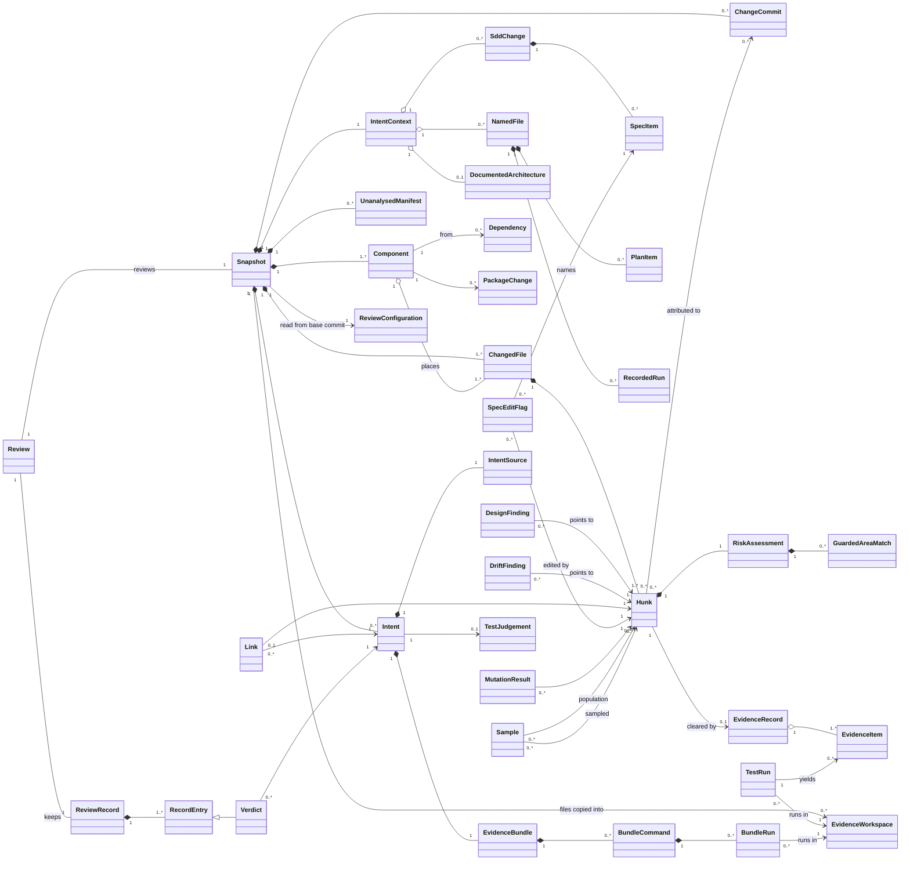

# C001 — Domain model

Terms keep the meaning of `glossary-delta.md`; this file adds attributes, relations, identity
rules and invariants. Serialised forms: C001-IF-008 (analysis results, the neutral intermediate
form of intents, hunks and evidence), C001-IF-009 (review record), C001-IF-004 (review
configuration). Lifecycles: `state-machines.md`. Owning components:
`60-architecture/architecture.md` §2.

## 1. Entity overview

## 2. Entities

### 2.1 Review
| Attribute | Type | Constraints |
|---|---|---|
| reviewId | string | equals the snapshot ID: one review per snapshot |
| repositoryRoot | path | absolute path of the working-tree root at intake |
| createdAt | timestamp | ISO 8601 with UTC offset |
| providerStatus | model-free or model-assisted, with the provider name | model-free when no provider is configured, the configuration cannot be read or a cloud provider lacks the opt-in (C001-REQ-801, C001-REQ-806, C001-REQ-819); per-item fallback is labelled on the item (§2.24) |
| sddChangeId | string or none | the SDD change the intents come from (C001-REQ-302, C001-REQ-303) |
| testCommand | string or none | given for the review, else the configuration's (C001-REQ-505) |
| attentionBudget | AttentionBudget or none | §2.20 |
| sampleSeed | 128-bit random value | drawn when the review is created (C001-INV-16) |

- **Relationships:** one Snapshot, one ReviewRecord; review sessions leave no state other than
  record entries.
- **Owning component:** C001-COMP-002; persisted by C001-COMP-014.
- **C001-INV-02** Every analysis result, read mark, clearing, hunk move and verdict refers to
  exactly one snapshot, and nothing recorded for one snapshot changes what is recorded for another
  (C001-REQ-118).

### 2.2 Snapshot
| Attribute | Type | Constraints |
|---|---|---|
| snapshotId | string | §3 |
| baseCommit | hash and subject line | C001-REQ-114 |
| baseChoice | named, upstream-merge-base, default-branch-merge-base, head | C001-REQ-102 to C001-REQ-104; cases of C001-IF-012 §4 |
| baseRef | full ref name or none | the upstream branch, or the default branch of the remote or local `main` or `master` whose merge base with HEAD is the base commit; none for named and head |
| namedValue | string or none | the value the developer named, kept verbatim |
| headCommit | hash | |
| changedFiles | list of ChangedFile | at least one (C001-REQ-107) |
| changedLines | integer | sum over text files |
| sizeWarning | boolean | true when changedLines > 10,000 or changed files > 300 (C001-REQ-121) |
| configuration | ReviewConfiguration | read from the base commit (C001-REQ-426) |
| content | blobs by SHA-256 | snapshot-side content of every changed text and binary file (C001-REQ-116) |

- **Owning component:** C001-COMP-004; stored by C001-COMP-014.
- **C001-INV-01** The snapshot ID is a function of the base commit, the HEAD commit and the path,
  change type, previous path and content hash of every changed file, and of nothing else
  (C001-REQ-115).

### 2.3 ChangedFile
| Attribute | Type | Constraints |
|---|---|---|
| path | repository-relative path, `/` separators | unique within the snapshot |
| oldPath | path or none | renamed files only |
| changeType | added, deleted, modified, renamed | C001-REQ-101 |
| binary | boolean | a binary file has no hunk and 0 changed lines (C001-REQ-108) |
| ecosystem | typescript-javascript, python, csharp-dotnet, other | C001-IF-005 §8 |
| contentHash | SHA-256 or none | none for a deleted file |
| mode | regular, executable, symbolic link, or none | snapshot side (C001-IF-012 G-07); none for a deleted file; fills evidence workspaces (§2.25) |
| componentId | component ID | §3 |

- **Owning component:** C001-COMP-004 (creation), C001-COMP-008 (component placement).
- **C001-INV-03** Every changed file belongs to exactly one component of the architecture delta
  (C001-REQ-202).

### 2.4 Hunk
A hunk is a maximal run of consecutive changed lines of one text file in a diff computed with no
context lines; the surrounding lines are shown, not part of it. The diff algorithm is fixed per
release (`60-architecture/constraints.md`, C001-CON-17).

| Attribute | Type | Constraints |
|---|---|---|
| hunkId | string | §3 |
| contentKey | SHA-256 | §3; compares hunks across snapshots (C001-REQ-715) |
| path | ChangedFile path | |
| oldRange, newRange | start line and line count | count 0 for a run of only added or only deleted lines |
| addedLines, deletedLines, changedLines | integers | changedLines = added + deleted |
| commits | list of commit hashes | commits that added or deleted its lines (C001-REQ-110) |
| uncommitted | boolean | holds changed lines not yet committed (C001-REQ-110) |
| isTestHunk | boolean | C001-REQ-501 |
| movePartner | hunk ID or none | the other half of a detected move (C001-REQ-406, C001-REQ-910) |
| reviewState | open, cleared, read, reopened | `state-machines.md` §1 |
| reopenCause | developer, evidence-lost, escalation, or none | C001-REQ-411, C001-REQ-422, C001-REQ-606 |
| inSample | boolean | §2.19 |
| labels | Labels | §2.24 (C001-REQ-212, C001-REQ-323) |

- **Owning component:** C001-COMP-004 (creation); review state by C001-COMP-010 (clearing) and
  C001-COMP-012 (read marks, escalation).
- **C001-INV-04** Each hunk is grouped under exactly one intent or under orphan code; alternative
  intents are listed on the hunk and do not group it (C001-REQ-301, C001-REQ-307).

### 2.5 ChangeCommit
Commit between the base commit and HEAD: hash, parents, author name and e-mail, author time,
message, subject line (first line), changed files (C001-REQ-109). Merge commits are included.
Owning component: C001-COMP-004.

### 2.6 IntentContext and its sources
| Entity | Attributes | Source rule |
|---|---|---|
| IntentContext | sddChanges, documentedArchitecture, commits, namedFiles | C001-REQ-109, C001-REQ-111, C001-REQ-112 |
| SddChange | id, title, origin (sdd-folder or neutral-file), location, open | C001-IF-007 §2, §5 |
| SpecItem | id, kind (requirement, task, scenario, acceptance criterion), title, text, textHash, links (target ID and type), files named, location (file, line), lines read in the snapshot and at the base commit | C001-IF-007 §3 |
| NamedFile | role (pull-request-text, agent-plan, agent-transcript), path, size, format (markdown, plain-text), text | C001-REQ-112, C001-IF-007 §7 |
| PlanItem | ordinal, title, text, textHash, location, files named | plan-item rule, C001-IF-007 §8 |
| RecordedRun | command, recorded output or none, location, intent keys it is linked to | C001-IF-007 §9 (C001-REQ-510) |

- **Owning component:** C001-COMP-005 (reading); assembled by C001-COMP-004.
- Text read from these sources is data; nothing in it is executed or followed
  (`60-architecture/constraints.md`, C001-CON-20).
- An entry of a `.sdd/` workspace (change folder, spec item, documented component) that has the
  form of such an entry but cannot be read is not part of the intent context; a notice ERR-SDD-005
  names its file, line and reason (C001-REQ-123, C001-IF-007 §2 to §4). A neutral file that does
  not conform stops intake instead (C001-REQ-124).
- The SDD change named at intake must be an open SDD change of the snapshot, else intake stops
  (C001-REQ-326).
- The SDD workspace and the documented architecture are also read at the base commit, only to know
  the lines each spec item and each documented component was read from there; these lines decide
  spec-edit flags (§2.11) and architecture-edit drift (§2.9) (C001-REQ-222, C001-REQ-328).

### 2.7 DocumentedArchitecture
Origin (sdd-folder or neutral-file), file, layers (ordered, top first, possibly empty), components
(id, name, layer or none, path patterns, allowed dependencies), lines read in the snapshot and at
the base commit (C001-REQ-207, C001-IF-007 §4). An architecture whose components declare no path
is not a documented architecture: it is dropped with notice ERR-SDD-004 naming its file, and the
components are derived (C001-REQ-223). Owning component: C001-COMP-005.

### 2.8 Component, Dependency and PackageChange (architecture delta)
| Entity | Attributes |
|---|---|
| Component | componentId (§3), name, origin (documented, derived, undocumented), layer or none, path patterns, counts of changed files, changed lines and hunks (C001-REQ-203), shares (§2.20) |
| Dependency | from component, to component or external package, change (added, removed), newCoupling, drift, hunk IDs, analysed (false for files outside the deep ecosystems, C001-REQ-212) |
| PackageChange | manifest path, ecosystem, package, previous version, new version, change (added, removed, re-versioned), hunk ID (C001-REQ-205) |
| UnanalysedManifest | manifest path, side (base commit or snapshot), parse error; no PackageChange is derived from that manifest, and the result is labelled reduced with notice ERR-ARCH-001 (C001-REQ-224) |

Owning component: C001-COMP-008. The hunks of an unanalysed manifest stay open in the dependency,
build and configuration guarded area (C001-REQ-416, C001-REQ-413).

### 2.9 DesignFinding and DriftFinding
- **DesignFinding:** findingId, kind (dependency-cycle, layer-bypass, duplicated-logic,
  design-critique), component IDs, hunk IDs, statement, model-output marker for design critique
  (C001-REQ-213 to C001-REQ-216).
- **DriftFinding:** kind (disallowed-dependency, outside-documented-components,
  architecture-edit), component ID, hunk IDs, statement (C001-REQ-208, C001-REQ-209,
  C001-REQ-222). An architecture-edit finding names one hunk, the file holding the documented
  architecture, and whether the hunk adds lines read in the snapshot, deletes lines read at the
  base commit, or both (C001-IF-007 §4). It is raised whenever such a hunk exists, also when the
  snapshot has no documented architecture because the change deleted it (drift otherwise not
  checked, C001-REQ-211). Drift is not a design-quality finding (glossary) and does not hold a
  hunk open by itself.
- **Owning component:** C001-COMP-008.

### 2.10 Intent and IntentSource
| Attribute | Type | Constraints |
|---|---|---|
| intentId | string | §3 |
| intentKey | string | §3; stable across snapshots |
| title | text | requirement title, commit subject line, plan-item title, model title or developer name; a developer name holds a character other than whitespace (C001-REQ-719) |
| kind | spec-requirement, extracted-commit, extracted-plan-item, extracted-model, developer-named | C001-REQ-305, C001-REQ-313 to C001-REQ-315, C001-REQ-709 |
| source | IntentSource: type (spec-item, commit, plan-item, transcript-passage, pull-request-text, developer), reference, location, text, textHash | C001-REQ-317; textHash feeds C001-REQ-717 |
| sourceOrder | integer | glossary, source order |
| accounts | deterministic account, model account or none | C001-REQ-324, C001-REQ-325 |
| marker | ModelOutputMarker or none | extracted-model only (C001-REQ-810) |

- **Derived:** unmet (no hunk grouped, C001-REQ-311), shares, current verdict and staleness
  (§2.21).
- **Owning component:** C001-COMP-009.
- A developer-named intent is created only for hunks that are all in orphan code (C001-REQ-720,
  ERR-ACT-005); a requirement the change deletes is neither an intent nor an unmet intent and is
  shown only by its spec-edit flag (C001-REQ-328).
- **C001-INV-15** Each intent has exactly one intent key, and an intent taken again from the same
  source in a later snapshot has the same key (§3). No two intents of one snapshot share a key: a
  developer name whose key equals that of another developer-named intent of the review is refused
  (C001-REQ-719, ERR-ACT-009).

### 2.11 Link, HunkMove and SpecEditFlag
- **Link:** hunk ID, target (intent ID or orphan code), link signal (CAP-03 requirements §1 or
  developer move), link confidence (high, medium, low, developer), link reason, alternative intent
  IDs, labels (C001-REQ-306 to C001-REQ-308, C001-REQ-319, C001-REQ-320). A model judgement that
  names an intent the intent map does not hold creates no link: the hunk is in orphan code, its
  grouping is labelled reduced, and the other model links of the same answer stand (C001-REQ-327,
  notice ERR-MODEL-011).
- **HunkMove:** hunk ID, previous grouping, new grouping, time; a record entry (C001-REQ-321).
- **SpecEditFlag:** spec item ID and kind, hunk ID, change (added: read in the snapshot only;
  deleted: read at the base commit only; modified: read on both sides), the intent concerned or
  none (C001-REQ-328). One flag per spec item and hunk, for every hunk that adds a line the spec
  item is read from in the snapshot or deletes a line it is read from at the base commit
  (C001-IF-007 §3). Computed with the static analysis of the snapshot (§4); flags change no
  grouping, clearing or verdict.
- **Owning component:** C001-COMP-009.

### 2.12 RiskAssessment and GuardedAreaMatch
| Attribute | Type | Constraints |
|---|---|---|
| guardedArea | boolean | true when at least one GuardedAreaMatch exists |
| size | integer | changed lines of the hunk |
| novelty | boolean | the change adds the hunk's file |
| testCoverage | share 0 to 1, unknown flag | unknown scores as 0 (C001-REQ-404) |
| dependencyChange | boolean | C001-REQ-401 |
| score | number ≥ 0 | monotone in each signal (C001-REQ-402); weights set in 20-plan |
| guardedAreas | list of GuardedAreaMatch: area (built-in ID or configured name) and the criterion that matched | C001-REQ-414 to C001-REQ-417, C001-REQ-423 |

- **Owning component:** C001-COMP-010.
- **C001-INV-14** A risk score is computed from these signals only, never from model output, so
  the same snapshot and configuration give the same scores (C001-REQ-405, C001-NFR-015).

### 2.13 EvidenceRecord
| Attribute | Type | Constraints |
|---|---|---|
| evidenceRecordId | string | unique within the snapshot |
| hunkId | hunk ID | |
| rules | non-empty set of clearing rules | every rule that cleared the hunk (C001-REQ-419) |
| items | evidence item IDs | the proof or the tests and their test run |
| clearedAt | timestamp | |
| withdrawn | time and cause, or none | evidence lost (C001-REQ-411), developer reopen (C001-REQ-422) or escalation (C001-REQ-606) |

- **Owning component:** C001-COMP-010.
- **C001-INV-06** A hunk is cleared only by one or more of the five clearing rules, and never while
  it lies in a guarded area, carries a design-quality finding other than design critique, its
  rule is disabled or escalated, or the review configuration cannot be read (C001-REQ-412,
  C001-REQ-413, C001-REQ-217, C001-REQ-418, C001-REQ-424, C001-REQ-609, C001-REQ-427).
- **C001-INV-07** Every cleared hunk has exactly one evidence record that is not withdrawn; it
  names every rule that cleared the hunk and holds at least one evidence item of evidence strength
  1 to 3 (C001-REQ-419, C001-REQ-518).

### 2.14 EvidenceItem
| Attribute | Type | Constraints |
|---|---|---|
| evidenceItemId | string | |
| subject | hunk ID or intent ID | |
| kind | deterministic-proof, test-result, mutation-result, property-counter-example, bundle-run, agent-reported | glossary, evidence item |
| strength | integer 1 to 5 | C001-REQ-518 |
| run | test run ID or bundle run ID, or none | none for proofs and agent-reported items |
| resultDigest | SHA-256 | of the result fields; a change marks relying verdicts stale (C001-REQ-716) |

- **Owning component:** C001-COMP-011 (runs), C001-COMP-010 (proofs).
- **C001-INV-08** Every evidence item is a deterministic proof, comes from a test run or bundle run
  whose evidence workspace matched the snapshot before and after the run (§2.25), comes from
  mutation testing in the mutation copy of such a test run's workspace (§2.25, C001-IF-013 §3
  item 3), or is labelled agent-reported with strength 5 (C001-REQ-509, C001-REQ-518). Edits of the working tree during or after a run
  change no evidence item (C001-REQ-522).

### 2.15 TestRun and TestResult
TestRun: testRunId, command, origin (developer or configuration), status
(`state-machines.md` §4), unavailability reason, start and end time, workspace check before and
after (C001-IF-013 §3), working-tree paths changed during the run (C001-IF-013 §9 item 3,
ERR-EVID-009), results, line coverage. TestResult: test ID, name, outcome (passed, failed, skipped),
property counter-example or none. Line coverage: for each added line of a deep-ecosystem hunk the
passing and failing tests that executed it (C001-REQ-506); for other files, executed or not, from
LCOV or Cobertura XML (C001-REQ-507). Owning component: C001-COMP-011.

### 2.16 MutationResult and PropertyCounterExample
- **MutationResult:** hunk ID, changed line, mutation applied, outcome (killed, survived,
  no-coverage, timeout, error), or unavailable with the reason (C001-REQ-514 to C001-REQ-516).
- **PropertyCounterExample:** test ID, shrunk input as reported, hunk IDs (C001-REQ-517).
- **Owning component:** C001-COMP-011.

### 2.17 TestJudgement
Intent ID, value (expresses, does-not-express), time; the latest record entry per intent applies
(C001-REQ-503). Exists only for an intent with at least one test hunk: a judgement on an intent
without test hunks is refused with ERR-ACT-007 (C001-REQ-520). Effect on qualifying tests:
C001-REQ-504. Owning component: C001-COMP-010.

### 2.18 EvidenceBundle, BundleCommand and BundleRun
- **BundleCommand:** commandId, command text, origin (developer, agent-run, scenario), confirmed,
  source location, the agent's recorded output or none. A developer-entered command is confirmed
  when entered; a proposed one only by the developer's confirmation (C001-REQ-510, C001-REQ-511).
- **BundleRun:** runId, commandId, exit status, standard output, standard error, truncation flags,
  start and end time, snapshot match (the workspace check of C001-IF-013 §3), working-tree paths
  changed during the run (C001-IF-013 §9 item 3, ERR-EVID-009), reference run
  (previous run ID or the agent's recorded output) and the differences from it (C001-REQ-512,
  C001-REQ-513).
- **Owning component:** C001-COMP-011.

### 2.19 ReadMark, Sample, DefectReport and Escalation
- **ReadMark:** hunk IDs, time; a record entry (C001-REQ-601).
- **Sample:** clearing rule, sample population, sampled hunk IDs in the order they entered, target
  size (C001-REQ-604, C001-REQ-616). Kept with the analysis results of the snapshot (C001-IF-008
  `RuleStatus`), updated by C001-INV-16 at every change of the population, saved with each
  revision and restored with it (C001-REQ-918, `60-architecture/architecture.md` §4.2); not a
  record entry of its own.
- **Sample results** of a rule (C001-REQ-614): sampled hunks, sampled hunks read and defects
  reported. They are derived from the sample and from the read-mark and defect-report entries of
  the record; there is no separate "sampling result" to save.
- **Sample population** of a rule: the hunks of the snapshot whose clearing by that rule has not
  been withdrawn, read or not (glossary). A hunk enters it when the rule clears it (also a read
  hunk, `state-machines.md` §1) and leaves it when that clearing is withdrawn: passing-tests
  evidence lost, for a read hunk as well (C001-REQ-411), developer reopen (C001-REQ-422) or the
  reopening of an unread hunk by escalation (C001-REQ-606). A read mark does not remove a hunk from
  it, and an escalation leaves a read hunk in it (`state-machines.md` §1).
- **DefectReport:** hunk ID, text, the rules that had cleared the hunk in the snapshot, possibly
  none, time; a record entry (C001-REQ-617). A report that names no rule escalates nothing.
- **Escalation:** defect report, escalated rules, reopened hunk IDs; a record entry written after a
  defect report that names at least one rule (C001-REQ-606, C001-REQ-607).
- **Owning component:** C001-COMP-012.
- **C001-INV-16** The target size of the sample of a clearing rule whose sample population holds n
  hunks is ⌈n / 10⌉, so at least one hunk when n ≥ 1 and none when n = 0. Each hunk of the
  population has a sample rank, the SHA-256 of (sample seed, rule, hunk ID), the sample seed being
  a random 128-bit value drawn when the review is created and stored with it. Whenever the
  population changes (C001-REQ-616): every sampled hunk that left the population leaves the
  sample; every sampled hunk still in the population stays; then, for a rule that is not
  escalated only, while the sample holds fewer hunks than the target, the unsampled population
  hunk of lowest rank enters; while it holds more, the unread sampled hunk of highest rank leaves,
  and a read sampled hunk never leaves while it is in the population, so the sample can exceed the
  target. An escalated rule takes no new hunk into its sample, even when the sample holds fewer
  hunks than the target: it keeps the sampled hunks still in its population, so its sample results
  count only hunks sampled before the escalation (C001-REQ-609, C001-REQ-614). The sample is
  therefore random for each new review, identical in every session of one review, and stable under
  the developer's reading (C001-REQ-604, C001-REQ-616, C001-REQ-918).

### 2.20 AttentionBudget, ReadingQueue, Shares and CoverageStatement
| Entity | Attributes |
|---|---|
| AttentionBudget | minutes, reading rate (changed lines per hour, default 300), both numbers greater than zero; a value that is not is refused with ERR-ACT-008 and the budget and rate in effect stay unchanged (C001-REQ-610, C001-REQ-611, C001-REQ-615) |
| ReadingQueue | derived: hunk ID, risk score, estimated reading minutes, risk per minute; within-budget run; remainder changed lines and risk sum (C001-REQ-610 to C001-REQ-612) |
| Shares | scope (change, intent, orphan code, component), read, cleared, open as shares of changed lines (C001-REQ-602, C001-REQ-605) |
| CoverageStatement | time; risk sum and share for read, cleared-verified, cleared-other, open; per rule: cleared, sampled, sampled read, defects (C001-REQ-613, C001-REQ-614) |

- **Owning component:** C001-COMP-012.
- **C001-INV-05** For every scope, the read, cleared and open shares add up to 100 % of its changed
  lines; a hunk with a read mark counts as read whether or not it was cleared, and a sampled hunk
  without a read mark counts as cleared (C001-REQ-602, C001-REQ-605).

### 2.21 Verdict and OrphanRejection
| Attribute | Type | Constraints |
|---|---|---|
| intent | intent ID, intent key, title, source | C001-REQ-712 |
| kind | sign, reject, defer | |
| text | reason (reject) or note (defer) | non-whitespace (C001-REQ-706) |
| openHunksConfirmed | number of open hunks and their changed lines, or none | sign only (C001-REQ-703) |
| basis | hunk IDs with content keys; evidence record, evidence item digests, bundle run and clearing IDs; source textHash | input of C001-REQ-715 to C001-REQ-717 |
| shares | Shares of the intent | C001-REQ-712 |
| coverageStatement | CoverageStatement | C001-REQ-712, C001-REQ-613 |
| user | git user name and e-mail of the repository | both non-blank (C001-REQ-712, C001-REQ-721, §2.22) |

- **OrphanRejection:** hunk ID, reason, time (C001-REQ-710); only for a hunk in orphan code, a
  grouped hunk being refused with ERR-ACT-005 (C001-REQ-720).
- **Derived:** the current verdict of an intent and its stale causes (hunks, evidence, source);
  the decision status of the review (C001-REQ-711).
- **Owning component:** C001-COMP-013.
- **C001-INV-09** A verdict names exactly one intent and one snapshot and exists only as the result
  of a developer action through the CLI or the local review UI (C001-REQ-702).
- **C001-INV-11** The current verdict of an intent is the latest verdict entry with its intent key
  over the review records of the repository; it is stale exactly when its basis differs from the
  present hunks, evidence results, clearings or source text (C001-REQ-708, C001-REQ-715 to
  C001-REQ-718).

### 2.22 ReviewRecord and RecordEntry
One file per review in the format of C001-IF-009: a header line, then one entry per line. Every
entry has a sequence number, a time, a kind, the surface (cli or ui), the git user and the hash of
the previous line. Entry kinds: read mark, hunk reopen, hunk move, intent created, orphan
rejection, test judgement, defect report, escalation, attention budget, bundle command added,
bundle command confirmed, verdict. Every entry results from one of the ten recorded actions of
C001-IF-003 §4 (read mark, hunk reopen, hunk move, intent creation, orphan-hunk rejection, test
judgement, defect report, attention budget, bundle command added or confirmed, verdict); an
escalation entry results from the defect report before it. The record entries, the samples and the
analysis results together are the review state that is saved and restored
(`60-architecture/architecture.md` §4.2). Owning component: C001-COMP-014 (persistence),
C001-COMP-013 (verdict content), C001-COMP-002 (git user of every entry).

- **C001-INV-10** Record entries are append-only: an entry once written is never altered or
  removed, and sequence numbers increase by one in the order in which the entries were received
  (C001-REQ-713, C001-REQ-917). Every entry carries a git user name and e-mail address that are
  both non-blank: an action that would write an entry while either is not set is refused with
  ERR-ACT-006 and writes nothing (C001-REQ-712, C001-REQ-721).

### 2.23 ReviewConfiguration
Source (base commit and path, or default), readable flag and error, enabled clearing rules, added
guarded areas, generated-file patterns, test path patterns, test command, coverage report paths,
scenario command template, minimum clone length, model provider (name, provider API, endpoint,
model, key reference), cloud opt-in setting, provider timeout, model-excluded path patterns,
maximum request size, ignored settings (C001-REQ-425). Format and defaults: C001-IF-004,
C001-IF-005 §9. A configuration that cannot be read, including one that names a provider API
other than the two of C001-REQ-805, makes the review clear no hunk and run in model-free mode
(C001-REQ-427, C001-REQ-819, notice ERR-CFG-001). Owning component: C001-COMP-006.

- **C001-INV-13** No request to a model provider contains content of a file on a model-excluded
  path, and no request reaches a cloud provider unless the configuration read from the base commit
  has the cloud opt-in setting (C001-REQ-806, C001-REQ-814).

### 2.24 Labels, ModelOutputMarker and Notice
- **Labels:** reduced (names the missing feature or signal, C001-REQ-804), model output (marker),
  stale (causes) (C001-REQ-911).
- **ModelOutputMarker:** provider name, model name, confidence level low (C001-REQ-810,
  C001-REQ-811).
- **Notice:** code from `50-interfaces/errors.md`, message, subject, count (C001-REQ-425,
  C001-REQ-427, C001-REQ-817).
- **Owning component:** C001-COMP-002 (collection), C001-COMP-015 (model markers and notices).
- **C001-INV-12** Every model output item carries a ModelOutputMarker and is ordered after the
  deterministic results reported for the same hunk, intent or component (C001-REQ-810 to
  C001-REQ-812).

### 2.25 EvidenceWorkspace
| Attribute | Type | Constraints |
|---|---|---|
| snapshotId | snapshot ID | the snapshot whose files it holds |
| kind | run workspace, mutation copy | a mutation copy is the workspace that mutation testing of the snapshot takes: the copy of the workspace of the test run after which it starts (the mutation workspace of C001-IF-013 §2 item 3, §5 item 1) |
| location | absolute path | outside the working-tree root and the git directory, below neither (C001-CON-22) |
| state | preparing, free, in use, copying | in use by at most one run (C001-IF-013 §2 item 3); each state is defined below |
| run | test run, mutation run or bundle run ID, or none | the run using it; for a mutation copy, the mutation run of the snapshot; none while preparing, free or copying |

- **States** (C001-IF-013 §2 item 3):
  - *preparing*: a run workspace being filled for a run that needs a workspace while none of the
    snapshot's workspaces is free;
  - *free*: a run workspace that holds the snapshot's files and that no run uses; the run that
    takes it resets it first;
  - *in use*: used by one run: a run workspace by a test run or a bundle run, a mutation copy by
    the mutation run from the start of the copy to the removal of the copy;
  - *copying*: the copy window of a run workspace, from the end of the check after the test run
    (C001-IF-013 §3) after which mutation testing starts to the end of the copy that mutation
    testing takes from it, whether the copy is complete or has failed. No run uses the workspace
    and it is not free; a run of the snapshot that needs a workspace in this window is served as
    C001-IF-013 §2 item 3 states (while no other workspace of the snapshot is free, it waits for
    the end of the copy and no workspace is prepared for it). When the copy ends, the
    workspace is in use by a run that waited for it, or else free.
- **Content:** a run workspace holds the files of the snapshot, filled and reset before every run
  as in C001-IF-013 §2 items 1 and 3, with ignored paths as set by the ADR named there (§2
  item 4). A mutation copy is a copy of the test run's workspace, ignored paths included, made
  self-contained as C001-IF-013 §2 item 3 states; mutation testing changes its files by design, it
  is never reset, and the workspace check does not apply to it (C001-IF-013 §3 item 3); whether
  its tests load its files is checked by C001-IF-013 §5 item 4.
- **Lifetime:** a run workspace is created when a run needs one and none of the snapshot's
  workspaces is free, and removed when the process that runs the snapshot's jobs ends. A mutation
  copy is created when the copy window of the test run's workspace starts, and removed when
  mutation testing of the snapshot ends, or as soon as the copy fails; it is never reset for
  another run and never kept or reused for a later run (C001-IF-013 §2 item 3, §8 item 3). A
  workspace of either kind left by an ended process is removed by the next (C001-IF-013 §2
  item 6). Not persisted and not part of the review state.
- **Owning component:** C001-COMP-011.
- Every evidence run starts in a workspace that holds the snapshot's files, and the review
  assistant writes nothing into the working tree, the index or the refs for a run (C001-REQ-521,
  C001-REQ-522, C001-CON-22). Project code that loads or writes working-tree files on its own is
  reported, not prevented: ERR-EVID-008 for execution, ERR-EVID-009 for changes, and ERR-EVID-010
  for a part of the working tree or the repository that was not observed for the whole run
  (C001-IF-013 §9). Files of the snapshot that the tests in a mutation copy load from another
  evidence workspace or from the working tree are reported with ERR-EVID-011, and the mutation
  evidence of their hunks is unavailable (C001-IF-013 §5 item 4, `state-machines.md` §5).

## 3. Identity rules
| Identifier | Rule | Stable across |
|---|---|---|
| snapshot ID | `s-` followed by the hex SHA-256 of the canonical JSON of base hash, HEAD hash and the changed files sorted by path, each as path, previous path, change type and content hash | identical repository states (C001-REQ-115) |
| hunk ID | `h-` followed by the first 16 hex digits of the SHA-256 of snapshot ID, path, old start, new start and content key | one snapshot |
| hunk content key | SHA-256 of the path and the changed lines with their `+` or `-` marker, line numbers excluded | snapshots; a shift of position is not a change of content (C001-REQ-715) |
| intent key | `spec:<SDD change ID>:<requirement ID>`; `commit:<hash>`; `plan:<plan file path>#<ordinal>`; `model:<SHA-256 of the normalised title>`; `dev:<normalised name>`. The **normalised** form of a text is the text whitespace-collapsed, then decomposed (Unicode NFD), case-folded with Unicode full default case folding and recomposed (NFC), so that two names compare equal exactly when they match under Unicode canonical caseless matching. Whitespace collapsing replaces each run of whitespace characters by one space and removes leading and trailing whitespace. The title and the name keep the text as written for display (C001-REQ-719) | snapshots |
| intent ID | `i-` followed by the first 16 hex digits of the SHA-256 of the intent key | snapshots |
| component ID | `doc:<documented component ID>`; `dir:<directory path>`; `undocumented` | snapshots |
| evidence record, item and run IDs | prefix (`er-`, `ei-`, `run-`) and a random 128-bit value in hex | one snapshot; excluded from reproducibility (C001-NFR-015) |

The plan file path is repository-relative when the file lies in the repository and absolute
otherwise.

## 4. Derived values
Computed from the stored entities on every read, never stored as facts of their own: shares
(C001-REQ-602), unmet intents (C001-REQ-311), intent order (C001-REQ-403, C001-REQ-502), reading
queue (C001-REQ-610), current verdict and stale causes (C001-REQ-708, C001-REQ-718), decision
status (C001-REQ-711), moved-on notice (C001-REQ-117), sample populations (C001-REQ-604, written
into each revision next to the sample) and sample results (C001-REQ-614). The sample itself is
stored, not derived, because it depends on the order of events (C001-INV-16).
Spec-edit flags and architecture-edit drift are computed once per snapshot with the static
analysis and stored with its results (C001-REQ-222, C001-REQ-328, C001-REQ-919).
