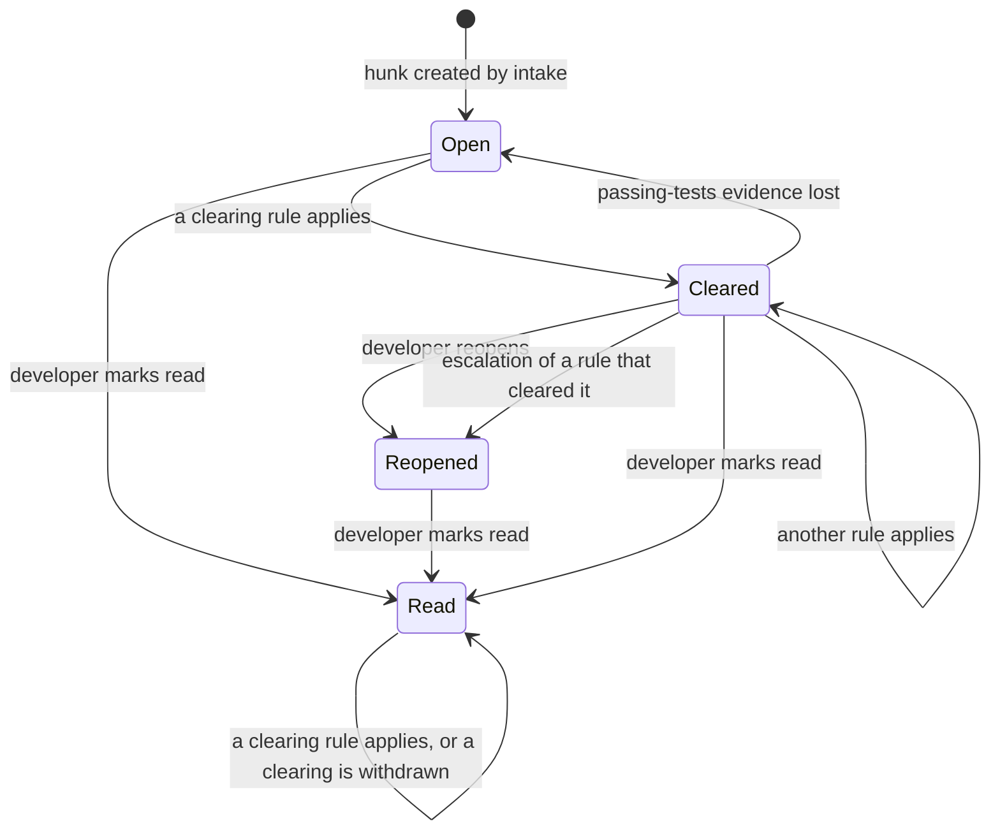
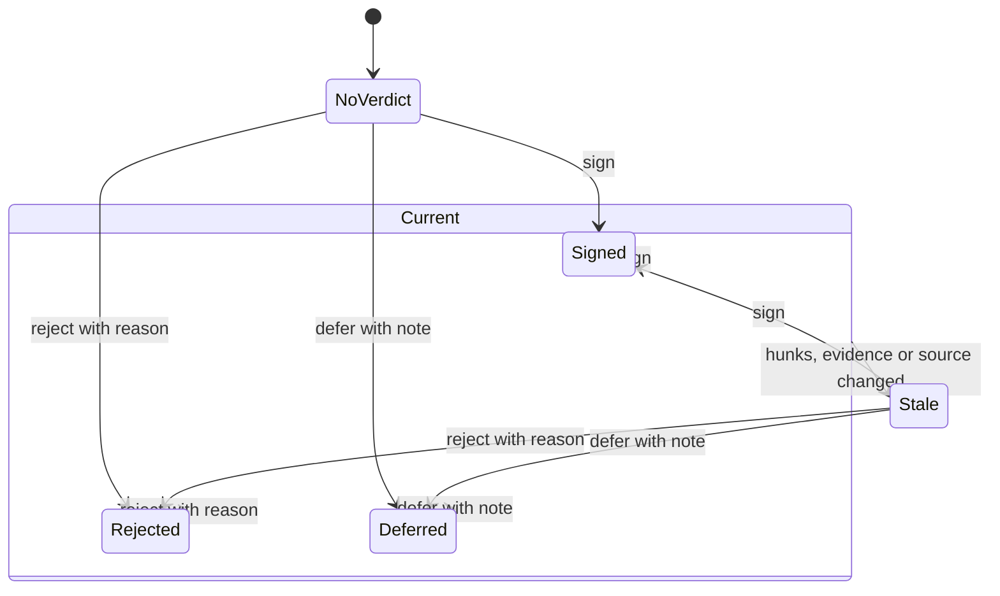
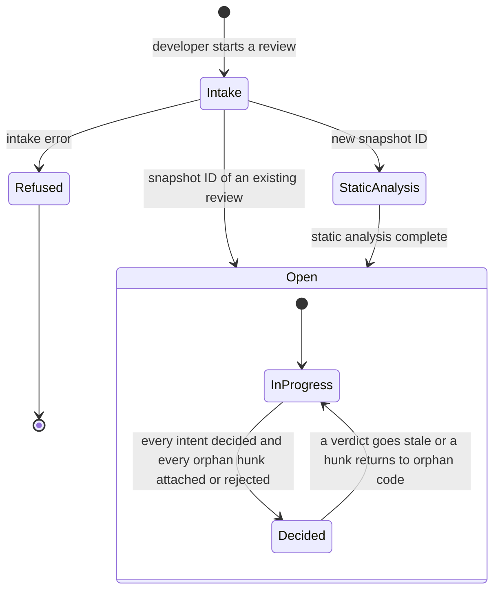
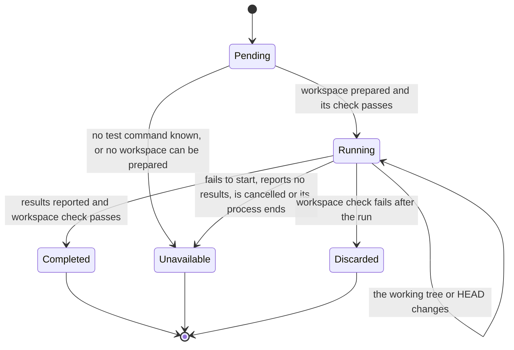
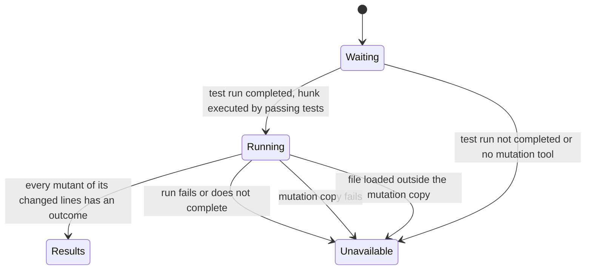
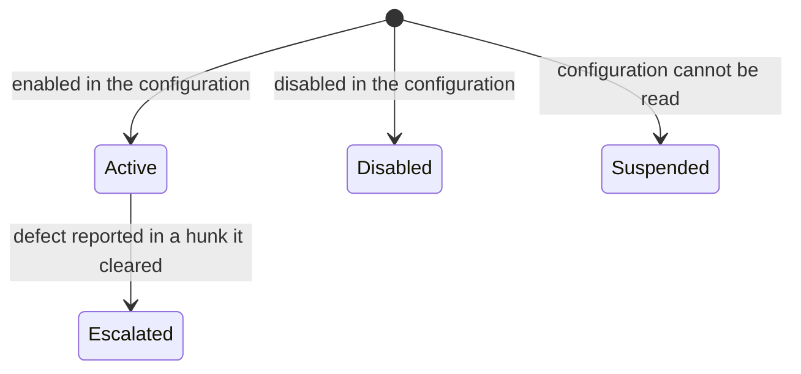
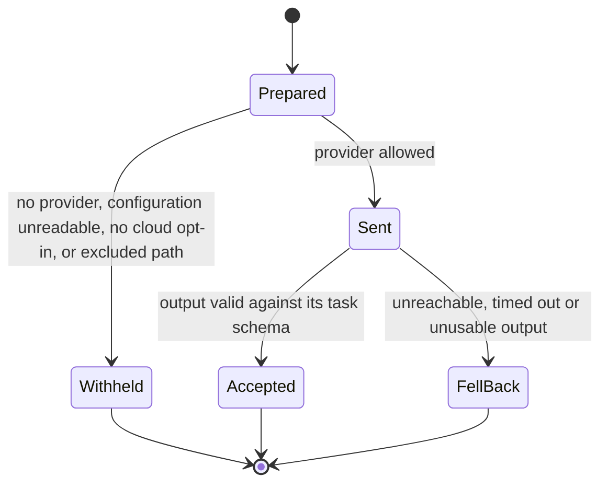
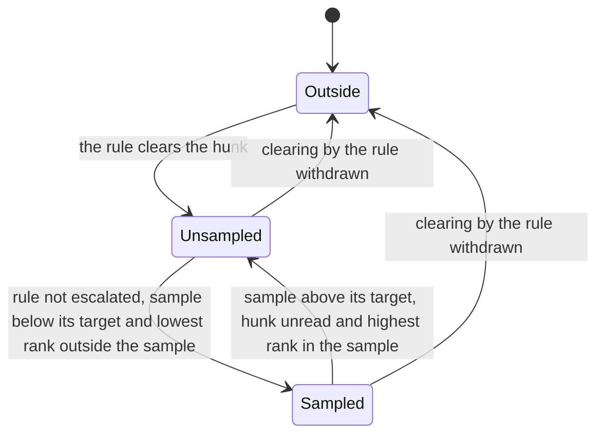
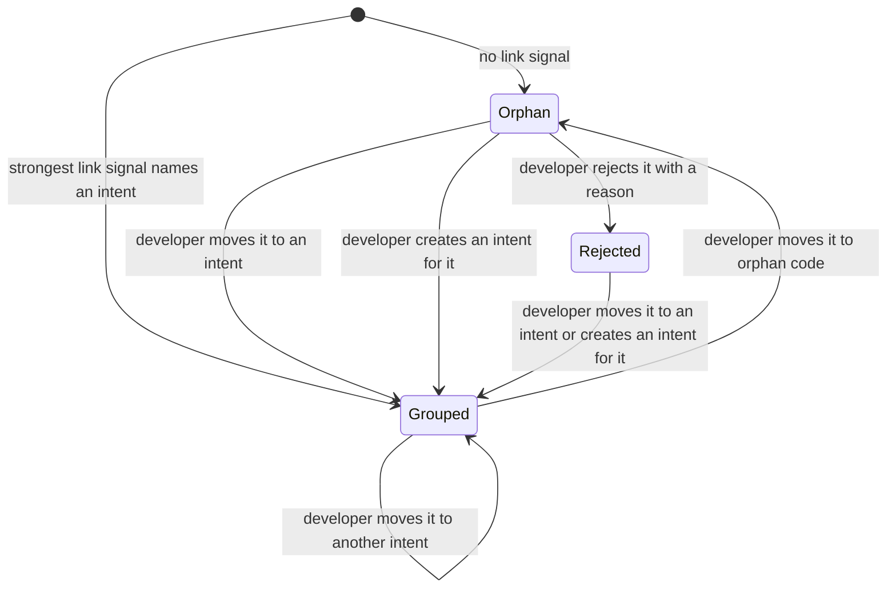

# C001 — State machines

Entities and attributes: `domain-model.md`. Every state below belongs to one snapshot; nothing
carries over to another snapshot except the current verdict of an intent key (§2, C001-INV-11).

**Developer actions and the git identity.** Every transition below triggered by one of the ten
recorded actions of `50-interfaces/core-api.md` §4 (read mark, hunk reopen, hunk move, intent
creation, orphan-hunk rejection, test judgement, defect report, attention budget, bundle command
added or confirmed, verdict) has the implicit guard "git `user.name` and `user.email` are set". When the guard fails the action is
refused with ERR-ACT-006, nothing is recorded and no state changes (C001-REQ-721, C001-INV-10).
Check order of the guards: `50-interfaces/core-api.md` §4.

## 1. Hunk review state

| From | Event | Guard | To | Effect |
|---|---|---|---|---|
| (none) | analysis creates the hunk | — | Open | risk assessment computed (C001-REQ-401) |
| Open | a clearing rule's conditions hold (C001-REQ-406 to C001-REQ-410) | rule enabled and not escalated; configuration readable; hunk in no guarded area; no design-quality finding other than design critique (C001-INV-06) | Cleared | evidence record attached (C001-REQ-419); the hunk enters the rule's sample population (§8) |
| Cleared | another rule's conditions hold | as above | Cleared | rule and items added to the evidence record; the hunk enters that rule's sample population |
| Cleared | the passing-tests conditions stop holding (later mutant, failed run, test judgement) | the passing-tests rule is the only rule that cleared it | Open | evidence record withdrawn with the condition that failed (C001-REQ-411); the hunk leaves the passing-tests population; verdicts relying on it go stale (C001-REQ-716) |
| Cleared | the passing-tests conditions stop holding | another rule also cleared it | Cleared | passing-tests rule removed from the evidence record (C001-REQ-411); the hunk leaves the passing-tests population only |
| Cleared | developer reopens the hunk | — | Reopened | cause developer; record entry (C001-REQ-422); the hunk leaves the population of every rule that cleared it |
| Cleared | escalation of a rule that cleared the hunk | the hunk has no read mark | Reopened | cause escalation, linked to the defect report (C001-REQ-606, C001-REQ-608); the hunk leaves the population of every rule that cleared it |
| Open, Reopened | developer marks the hunk, or all open hunks of its intent, read | — | Read | read-mark entry (C001-REQ-601) |
| Cleared | developer marks the hunk read (a sampled or expanded hunk) | — | Read | read-mark entry; the evidence record stays and the hunk stays in its populations (C001-REQ-602, C001-REQ-604) |
| Read | a clearing rule's conditions hold | guards of the first row | Read | evidence record attached; the hunk enters the rule's population and still counts as read (C001-REQ-602) |
| Read | the passing-tests conditions stop holding (later mutant, failed run, test judgement) | the passing-tests rule cleared the hunk | Read | passing-tests rule removed from the evidence record, which is withdrawn with the condition that failed when no other rule cleared the hunk (C001-REQ-411); the hunk leaves the passing-tests population and, if sampled, that rule's sample (§8); the read mark stays and the hunk still counts as read (C001-REQ-602); verdicts relying on the clearing go stale (C001-REQ-716) |
| Read | escalation of a rule that cleared the hunk | — | Read | none: the read mark stays, the evidence record and the population memberships stay, so the escalated rule's sample results keep the read sampled hunks, the reported one included (C001-REQ-606, C001-REQ-614); the escalated rule takes no further hunk into its sample (C001-INV-16) |
| Reopened | a clearing rule's conditions hold | — | Reopened | none: a reopened hunk stays open for the rest of the review (C001-REQ-422, C001-REQ-606) |

A read hunk is never reopened by escalation (C001-REQ-606), and a read mark is not withdrawn.
Every change of a sample population updates the rule's sample by C001-INV-16 (§8).

## 2. Intent verdict

| From | Event | Guard | To | Effect |
|---|---|---|---|---|
| any | sign action naming this intent only | the intent has no open hunk, or the developer confirmed the prompt stating the number of open hunks and their changed lines | Signed | verdict entry with basis, shares, coverage statement and git user (C001-REQ-701, C001-REQ-703, C001-REQ-712) |
| any | sign action | open hunks and the prompt declined or not confirmed | unchanged | nothing recorded (C001-REQ-703) |
| any | sign action naming more than one intent | — | unchanged | refused, ERR-ACT-003 (C001-REQ-702) |
| any | reject with reason | reason has a non-whitespace character | Rejected | verdict entry with the reason (C001-REQ-704) |
| any | defer with note | note has a non-whitespace character | Deferred | verdict entry with the note (C001-REQ-705) |
| any | reject or defer | text empty or whitespace only | unchanged | refused, ERR-ACT-001 (C001-REQ-706) |
| any | sign, reject or defer | git `user.name` or `user.email` not set; checked before the open-hunk prompt | unchanged | refused, ERR-ACT-006; no prompt shown (C001-REQ-721) |
| Signed, Rejected, Deferred | the hunks of the intent differ from the verdict's basis (new snapshot, hunk move, attached orphan hunk) | — | Stale | cause "hunks"; no entry written (C001-REQ-715, C001-REQ-713) |
| Signed, Rejected, Deferred | a relied-on evidence item changes its result digest, or a relied-on clearing is withdrawn | — | Stale | cause "evidence" (C001-REQ-716) |
| Signed, Rejected, Deferred | the source textHash differs from the basis | — | Stale | cause "source" (C001-REQ-717) |
| Stale | any verdict | guards as above | Signed, Rejected or Deferred | the new entry is the current verdict (C001-REQ-708) |

Stale is derived on every read from the latest verdict entry and the present state (C001-INV-11);
it reports every cause that holds (C001-REQ-718). A verdict never changes the repository
(C001-REQ-707).

## 3. Review lifecycle

| From | Event | Guard | To | Effect |
|---|---|---|---|---|
| (none) | `review` or `analyse` command | — | Intake | base commit chosen (C001-REQ-102 to C001-REQ-104) |
| Intake | not a git working tree, no commit, unknown base, unreadable named file, ambiguous SDD change, named SDD change not open in the snapshot, invalid neutral intent-and-architecture file, empty change | — | Refused | no snapshot created; error of `50-interfaces/errors.md` (C001-REQ-105 to C001-REQ-107, C001-REQ-113, C001-REQ-124, C001-REQ-304, C001-REQ-326) |
| Intake | snapshot ID computed | no review with that ID | StaticAnalysis | snapshot stored; intake summary shown with the notices of skipped `.sdd/` entries and of an architecture without component paths (C001-REQ-114, C001-REQ-115, C001-REQ-123, C001-REQ-223) |
| Intake | snapshot ID computed | a review with that ID exists | Open | recorded results reused, not recomputed; unfinished jobs resumed (C001-REQ-119, C001-REQ-919) |
| StaticAnalysis | architecture delta (with architecture-edit drift and unanalysed manifests), deterministic intent map (with spec-edit flags), risk scores, deterministic clearings and samples recorded | — | Open | architecture delta shown first (C001-REQ-201, C001-REQ-222, C001-REQ-224, C001-REQ-328, C001-REQ-604); test run and model tasks start (§4, §7) |
| InProgress | decision status reaches zero intents without a current non-stale verdict and zero unattached, unrejected orphan hunks | — | Decided | none (derived, C001-REQ-711) |
| Decided | a verdict goes stale or an intent or orphan hunk appears | — | InProgress | none (derived) |

A review is never closed or deleted by the review assistant (C001-REQ-118). The moved-on notice
(C001-REQ-117) is a flag computed when the review is resumed, a verdict is recorded or the
developer asks for a check; it does not change the lifecycle state.

## 4. Test run
Runs happen in an evidence workspace (`50-interfaces/evidence-runs.md` §2); "workspace check" is
the check of its §3.

| From | Event | Guard | To | Effect |
|---|---|---|---|---|
| Pending | static analysis complete | no test command for the review or in the configuration | Unavailable | reason recorded, ERR-EVID-001 (C001-REQ-508) |
| Pending | workspace preparation | the workspace cannot be prepared, or its check before the start fails | Unavailable | not run; reason recorded, ERR-EVID-002 (C001-REQ-508) |
| Pending | workspace preparation | workspace prepared and its check passes | Running | command started in the workspace (C001-REQ-505, C001-REQ-521) |
| Running | a file of the working tree or HEAD changes | — | Running | none: the run continues on the snapshot's files; the moved-on notice reports the change (C001-REQ-522, C001-REQ-117) |
| Running | process cannot start, ends without test results, developer cancels, or the analysis core's process ends | — | Unavailable | reason recorded, ERR-EVID-002 to ERR-EVID-004; the analysis core has changed nothing in the working tree (C001-REQ-508, C001-REQ-521, `50-interfaces/evidence-runs.md` §9 item 1); after an unexpected end of the analysis core's process nothing is recorded and the run starts again in a fresh workspace when the review is reopened (C001-REQ-919) |
| Running | process ends | workspace check after the run fails | Discarded | no result recorded as evidence, ERR-EVID-005 (C001-REQ-509) |
| Running | process ends with test results | workspace check after the run passes | Completed | per-line coverage from files inside the workspace recorded, execution of working-tree files reported with ERR-EVID-008 (C001-REQ-506, C001-REQ-507); paths of the working tree, the index or refs changed during the run reported with ERR-EVID-009 (C001-REQ-523), and an incomplete observation of them reported with ERR-EVID-010 (C001-REQ-524), in this row and in the rows to Discarded and Unavailable; passing-tests clearing evaluated (C001-REQ-410); mutation testing starts (§5) |

ERR-EVID-009 changes no transition: the workspace check alone decides between Completed and
Discarded (`50-interfaces/evidence-runs.md` §3 item 4, §9 item 3).

Unavailable and Discarded both make the snapshot's test evidence unavailable: no hunk clears by
the passing-tests rule and test coverage scores as unknown (C001-REQ-404, C001-REQ-410). A
Completed run stays Completed when the working tree changes later (C001-REQ-522).

## 5. Mutation evidence of a hunk

| From | Event | Guard | To | Effect |
|---|---|---|---|---|
| Waiting | test run Completed | hunk in a deep-ecosystem file and executed by passing tests | Running | the test run's workspace is copied for mutation testing (copy window, `50-interfaces/evidence-runs.md` §2 item 3, `domain-model.md` §2.25); hunks taken in descending risk score in that mutation copy, which no other run uses (C001-REQ-514, `50-interfaces/evidence-runs.md` §5); mutated code never reaches the working tree (C001-REQ-521) |
| Waiting | test run Unavailable or Discarded, or no mutation tool for the ecosystem | — | Unavailable | reason recorded, ERR-EVID-006 (C001-REQ-516) |
| Running | outcomes complete | — | Results | surviving mutants recorded with line and mutation (C001-REQ-515); a survivor reopens a test-cleared hunk (C001-REQ-411) |
| Running | tool error, time-out or session end without completion | — | Unavailable | reason recorded (C001-REQ-516); test evidence has strength 3 (C001-REQ-518) |
| Running | the copy of the test run's workspace fails (for example for lack of disk space) | — | Unavailable | reason recorded with the cause of the failure, ERR-EVID-006 (C001-REQ-516), for this hunk and every other hunk that mutation testing was to take; the partial copy is removed and the copy window ends (`50-interfaces/evidence-runs.md` §2 item 3, `domain-model.md` §2.25); test evidence has strength 3 (C001-REQ-518) |
| Running | the self-containment check reports execution of the hunk's file under another evidence workspace of the snapshot or under the working-tree root (`50-interfaces/evidence-runs.md` §5 item 4) | — | Unavailable | no mutant of the file counts as killed or surviving; reason "loaded outside the mutation workspace" recorded, notice ERR-EVID-011 instead of ERR-EVID-006 (C001-REQ-516); mutation testing of the other files goes on; test evidence has strength 3 (C001-REQ-518) |

The copy and the self-containment check take place after the hunks enter Running and before any
of their mutants is run (`50-interfaces/evidence-runs.md` §2 item 3, §5 item 4): a failed copy
makes every hunk in Running Unavailable at once, and the check makes Unavailable only the hunks of
the files it reports.

## 6. Clearing rule in a snapshot

| From | Event | Guard | To | Effect |
|---|---|---|---|---|
| (none) | configuration read from the base commit | rule enabled | Active | clears hunks under its conditions |
| (none) | configuration read | rule disabled | Disabled | clears nothing (C001-REQ-424) |
| (none) | configuration cannot be read | — | Suspended | clears nothing; notice ERR-CFG-001; every model request is withheld (§7) (C001-REQ-427, C001-REQ-819) |
| Active | developer reports a defect in a hunk the rule cleared | — | Escalated | unread hunks it cleared reopen; escalation entry (C001-REQ-606, C001-REQ-607); clears nothing more (C001-REQ-609); its sample takes no new hunk (C001-INV-16, §8) |

Disabled, Suspended and Escalated last for the rest of the review of the snapshot.

## 7. Model request

| From | Event | Guard | To | Effect |
|---|---|---|---|---|
| Prepared | gateway check | no provider configured | Withheld | items produced in model-free mode and labelled reduced (C001-REQ-801, C001-REQ-804) |
| Prepared | gateway check | review configuration cannot be read, including a provider API other than the two supported | Withheld | model-free; notice ERR-CFG-001 (C001-REQ-819) |
| Prepared | gateway check | cloud provider without the cloud opt-in setting | Withheld | model-free; notice ERR-MODEL-001 (C001-REQ-806, C001-REQ-817) |
| Prepared | gateway check | content on a model-excluded path | Withheld | those items model-free; notice ERR-MODEL-002 (C001-REQ-814, C001-REQ-815) |
| Prepared | gateway check passes | cloud provider | Sent | announced first in the CLI and shown in the UI (C001-REQ-807, C001-REQ-808) |
| Sent | response | parses and validates against C001-IF-011 | Accepted | items marked as model output, confidence low (C001-REQ-810, C001-REQ-811); a hunk link to an intent the intent map does not hold is dropped for that hunk only, notice ERR-MODEL-011 (C001-REQ-327) |
| Sent | connection failure, error status, time-out or invalid output | — | FellBack | none of the output used; model-free items; notice of its cause, ERR-MODEL-003 to ERR-MODEL-010 (`50-interfaces/model-provider.md` §7); review state unchanged (C001-REQ-816 to C001-REQ-818) |

## 8. Sample membership of a hunk for one clearing rule
Rule and ranks: C001-INV-16; population: `domain-model.md` §2.19.

| From | Event | Guard | To | Effect |
|---|---|---|---|---|
| Outside | the rule clears the hunk (§1, rows to Cleared or Read) | — | Unsampled | the population grows by one; the target ⌈n / 10⌉ is recomputed (C001-REQ-604) |
| Unsampled | population changed | the rule is not escalated, the sample holds fewer hunks than the target and this hunk has the lowest rank among unsampled population hunks | Sampled | enters the sample; unread, it joins the reading queue (C001-REQ-610, C001-REQ-616) |
| Unsampled | population changed | the rule is escalated | Unsampled | none: an escalated rule takes no new hunk into its sample, even when the sample holds fewer hunks than the target (C001-INV-16, C001-REQ-609) |
| Sampled | population changed | the rule is not escalated, the sample holds more hunks than the target, the hunk has no read mark and the highest rank among unread sampled hunks | Unsampled | leaves the sample and the reading queue (C001-REQ-616) |
| Sampled | population changed | the hunk has a read mark | Sampled | none: a read sampled hunk never leaves while it is in the population, so the sample results stay true (C001-REQ-614, C001-REQ-616) |
| Unsampled, Sampled | the clearing by the rule is withdrawn (passing-tests evidence lost, also for a read hunk; developer reopen; escalation reopening the unread hunk) | — | Outside | the population shrinks; the sample of a rule that is not escalated is refilled from the population by the rows above; the sample of an escalated rule only shrinks (C001-REQ-411, C001-REQ-422, C001-REQ-606, C001-REQ-616, C001-INV-16) |

Population changes are evaluated one event at a time; after each, the sample of a rule that is not
escalated is brought to its target, and the sample of an escalated rule takes no new hunk. An
escalated rule clears no further hunk (C001-REQ-609), so its population and its sample can only
shrink. A read mark does not change the membership (C001-REQ-604), and an escalation does not
change the membership of a read hunk (§1).

## 9. Grouping of a hunk

| From | Event | Guard | To | Effect |
|---|---|---|---|---|
| (none) | deterministic or model linking | a link to an intent of the intent map | Grouped | link with signal, confidence and reason (C001-REQ-306 to C001-REQ-308) |
| (none) | deterministic or model linking | no link, or the model names an intent the map does not hold | Orphan | grouping labelled reduced in the second case, notice ERR-MODEL-011 (C001-REQ-309, C001-REQ-327) |
| Orphan, Rejected | developer moves the hunk to an intent | — | Grouped | hunk-move entry with link confidence developer; verdicts of the intent go stale on hunks (C001-REQ-320, C001-REQ-321, C001-REQ-715) |
| Grouped | developer moves the hunk to orphan code or to another intent | — | Orphan or Grouped | hunk-move entry; verdicts of the intents concerned go stale on hunks (C001-REQ-320, C001-REQ-321, C001-REQ-715) |
| Orphan, Rejected | developer creates an intent for this hunk and others | every hunk named is in orphan code; the name holds a non-whitespace character and its normalised form (`domain-model.md` §3) is not that of another developer-named intent of the review | Grouped | intent-created entry; the hunks are grouped under the new intent with link confidence developer (C001-REQ-709) |
| Orphan | developer rejects the hunk | reason holds a non-whitespace character | Rejected | orphan-rejection entry (C001-REQ-710) |
| Grouped | developer creates an intent for it, or rejects it as orphan code | — | unchanged | refused, ERR-ACT-005 naming the intent (C001-REQ-720) |
| Orphan, Rejected | developer creates an intent | name empty or whitespace only, or its normalised form already used, case differences included | unchanged | refused, ERR-ACT-001 or ERR-ACT-009 (C001-REQ-719) |

Rejected is a state within orphan code: the hunk stays in the orphan-code list and counts as
decided in the decision status (C001-REQ-711). Once the hunk is grouped under an intent it is
decided through that intent's verdict; the rejection entry stays in the record (C001-REQ-722,
C001-REQ-713).
