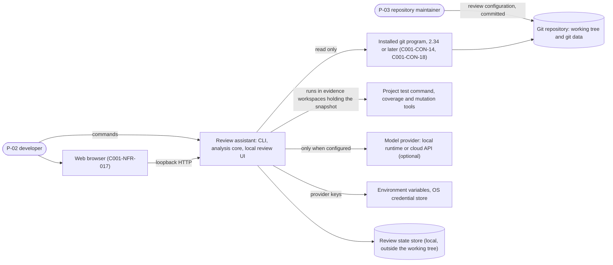
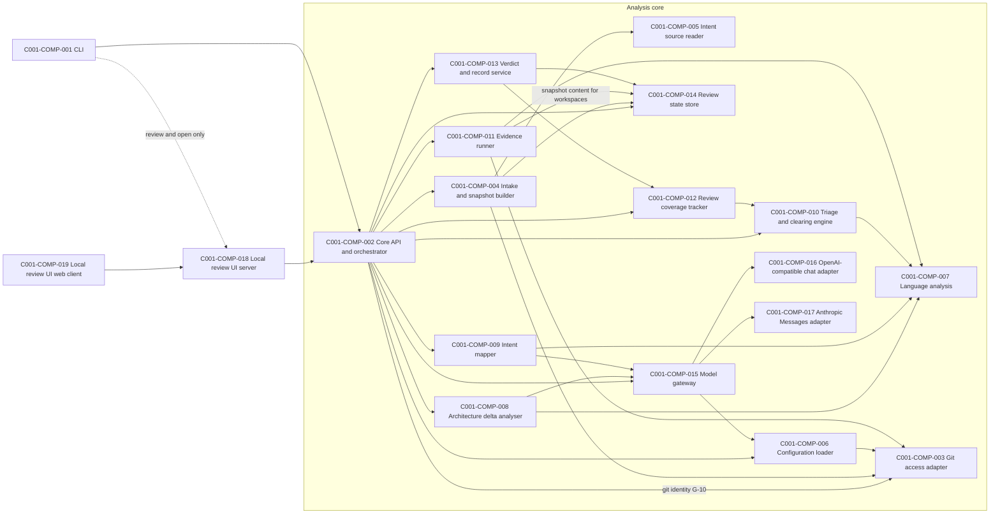

# C001 — Architecture

Greenfield (`10-context/current-state.md`): every component is new and no cartographer evidence
applies. Form factor: C001-DEC-002 (analysis core with CLI plus a standalone local UI). Terms:
`40-domain/glossary-delta.md`; entities: `40-domain/domain-model.md`; interfaces:
`50-interfaces/README.md`; constraints: `constraints.md`.

## 1. Context and scope
The review assistant runs entirely on the developer's machine. It reads one git repository, runs
the project's own commands, serves one local page per review to the developer's browser, and
reaches a model provider only when the repository's review configuration names one
(C001-CON-01, C001-CON-11).



| External actor or system | Interaction | Boundary rule |
|---|---|---|
| P-02 developer | runs the CLI, reviews in the browser, gives verdicts | the only source of verdicts (C001-REQ-702) |
| P-03 repository maintainer | commits the review configuration | read from the base commit (C001-REQ-426) and trusted as the project's own code: it sets the test command an analysis runs (C001-IF-004, trust boundary) |
| Git repository | change, commits, configuration, attributes; submodule repositories | read-only (C001-IF-012, C001-CON-13) |
| Installed git program | implementation of the git access port (C001-ADR-004) | a prerequisite the developer installs, run only as a separate program with the hardening profile of C001-ADR-004, never linked or shipped (C001-CON-14, C001-CON-18) |
| Project test command, coverage and mutation tools | evidence runs on the snapshot | run as the developer's commands, started in evidence workspaces outside the working tree, never in it; project code that addresses the working tree on its own is detected and reported, not prevented (C001-IF-013 §9, C001-CON-22) |
| Model provider | model tasks | through the model gateway only (C001-IF-010, C001-CON-12) |
| Web browser | renders the local review UI | loopback, same origin, token (C001-IF-002, C001-CON-10) |
| Environment and credential store | provider keys | read only (C001-CON-21) |

Out of the boundary: hosting platforms, other surfaces (IDE, agent launcher), other machines
(`10-context/scope.md` §2).

## 2. Component catalogue
The analysis core (glossary system name) is C001-COMP-002 together with the components it uses,
C001-COMP-003 to C001-COMP-017. The local review UI (glossary system name) is C001-COMP-018 and
C001-COMP-019. The CLI is C001-COMP-001.

### C001-COMP-001 — CLI
- **Name:** CLI
- **Status:** new
- **Responsibility:** parses the commands of C001-IF-001, calls the core API, prints the intake
  summary, notices, the cloud provider announcement and results, writes headless output, starts
  the UI server for `review` and `open`, opens the browser or prints the address, and maps every
  outcome to an exit code.
- **Realizes:** C001-REQ-114, C001-REQ-117, C001-REQ-121, C001-REQ-317, C001-REQ-808, C001-REQ-901, C001-REQ-902, C001-REQ-912, C001-REQ-914, C001-REQ-915, C001-REQ-916, C001-NFR-016
- **Interfaces:** provides C001-IF-001; uses C001-IF-003; writes C001-IF-008 and C001-IF-009 files
- **Depends on:** C001-COMP-002, C001-COMP-018 (only for `review` and `open`, C001-CON-09)
- **Owned data:** none (command options only)

### C001-COMP-002 — Analysis core: core API and orchestrator
- **Name:** Core API and orchestrator
- **Status:** new
- **Responsibility:** the analysis core's only entry point (C001-IF-003): runs intake, then static
  analysis, publishes the architecture delta, then schedules background jobs (test run, mutation
  testing, model tasks, bundle runs) that publish later results as new revisions; passes data
  between the analysis components; routes every write operation to the component that validates
  it and to the store, reading the git identity for each and refusing the operation while it is
  not set (C001-IF-003 §4); handles the events of a snapshot one at a time and saves each revision
  before showing it; reopens reviews without recomputing, re-applying the record entries that an
  unexpected end left unapplied (§4.2); collects labels and notices.
- **Realizes:** C001-REQ-119, C001-REQ-201, C001-REQ-721, C001-REQ-802, C001-REQ-913, C001-REQ-918, C001-REQ-919, C001-NFR-001, C001-NFR-004, C001-NFR-013, C001-NFR-015, C001-NFR-016
- **Interfaces:** provides C001-IF-003 and C001-IF-008; uses C001-IF-012 (G-10)
- **Depends on:** C001-COMP-003, C001-COMP-004, C001-COMP-006, C001-COMP-008, C001-COMP-009, C001-COMP-010, C001-COMP-011, C001-COMP-012, C001-COMP-013, C001-COMP-014, C001-COMP-015
- **Owned data:** Review, Labels, Notice, revision counter, job states

### C001-COMP-003 — Git access adapter
- **Name:** Git access adapter
- **Status:** new
- **Responsibility:** implements the read-only git access port under its safety rules (no write,
  no repository-configured program, no network) by running the installed git program
  (C001-ADR-004); checks the program and the repository before the first git read of each
  command (C001-IF-012 §6); compares every file under no clean filter by its working-tree bytes,
  whatever git's index records for it, and reads a path outside a sparse checkout from its index
  entry (C001-IF-012 §8); reads the submodule repositories that fill evidence workspaces under
  the same rules (G-16).
- **Realizes:** C001-REQ-101, C001-REQ-120, C001-REQ-125, C001-REQ-126, C001-REQ-127, C001-REQ-128, C001-REQ-526, C001-REQ-527, C001-REQ-707
- **Interfaces:** provides C001-IF-012
- **Depends on:** none (external: the installed git program, C001-CON-14, C001-CON-18)
- **Owned data:** none

### C001-COMP-004 — Intake and snapshot builder
- **Name:** Intake and snapshot builder
- **Status:** new
- **Responsibility:** chooses the base commit (named, merge base with the upstream branch, with
  the default branch of the remote or a local `main` or `master`, else HEAD; C001-IF-012 §4),
  computes the change, cuts hunks, attributes them to commits, gathers the intent context through the intent source reader, measures the size,
  computes the snapshot ID, stores the snapshot content, and detects a moved-on working tree.
- **Realizes:** C001-REQ-101, C001-REQ-102, C001-REQ-103, C001-REQ-104, C001-REQ-105, C001-REQ-106, C001-REQ-107, C001-REQ-108, C001-REQ-109, C001-REQ-110, C001-REQ-112, C001-REQ-114, C001-REQ-115, C001-REQ-116, C001-REQ-117, C001-REQ-120, C001-REQ-121, C001-REQ-122, C001-REQ-125, C001-REQ-126, C001-REQ-127, C001-REQ-128
- **Interfaces:** uses C001-IF-012 and C001-IF-007
- **Depends on:** C001-COMP-003, C001-COMP-005, C001-COMP-014
- **Owned data:** Snapshot, ChangedFile, Hunk, ChangeCommit, IntentContext

### C001-COMP-005 — Intent source reader
- **Name:** Intent source reader
- **Status:** new
- **Responsibility:** reads the `.sdd/` workspace and the neutral file of the snapshot, the named
  pull-request text, plans and transcripts; skips unreadable `.sdd/` entries with a notice and
  stops intake on an invalid neutral file; drops an architecture without component paths with a
  notice; selects the SDD change and refuses one that is not open; records the lines each spec item
  and documented component is read from, in the snapshot and at the base commit; applies the
  plan-item rule; finds recorded runs and the ID and file mentions behind the link signals.
- **Realizes:** C001-REQ-111, C001-REQ-112, C001-REQ-113, C001-REQ-123, C001-REQ-124, C001-REQ-207, C001-REQ-223, C001-REQ-302, C001-REQ-303, C001-REQ-304, C001-REQ-314, C001-REQ-326
- **Interfaces:** provides C001-IF-007; reads C001-IF-006
- **Depends on:** none (works on content handed over by C001-COMP-004)
- **Owned data:** SddChange, SpecItem, NamedFile, PlanItem, RecordedRun, DocumentedArchitecture

### C001-COMP-006 — Configuration loader
- **Name:** Configuration loader
- **Status:** new
- **Responsibility:** reads the review configuration from the base commit, removes and reports
  settings that weaken built-in guarded areas, validates the rest, merges it with the built-in
  policy, and yields the effective configuration or the unreadable state.
- **Realizes:** C001-REQ-409, C001-REQ-423, C001-REQ-424, C001-REQ-425, C001-REQ-426, C001-REQ-427, C001-REQ-801, C001-REQ-809, C001-REQ-819, C001-REQ-820
- **Interfaces:** reads C001-IF-004; provides C001-IF-005; uses C001-IF-012
- **Depends on:** C001-COMP-003
- **Owned data:** ReviewConfiguration

### C001-COMP-007 — Language analysis
- **Name:** Language analysis
- **Status:** new
- **Responsibility:** parses files of the deep ecosystems at the base commit and in the snapshot:
  symbols, definitions and uses, import and reference statements, package manifests, public API,
  abstract-syntax-tree equality and name resolution, executable lines; assigns ecosystems and
  falls back to the language-agnostic core with a reduced label. Parser choice: ADR in 20-plan.
- **Realizes:** C001-NFR-008
- **Interfaces:** uses C001-IF-005 §7, §8, §10
- **Depends on:** none (external: syntax parsers)
- **Owned data:** symbol index per snapshot (derived, cache)

### C001-COMP-008 — Architecture delta analyser
- **Name:** Architecture delta analyser
- **Status:** new
- **Responsibility:** places every changed file in one component (documented, derived or
  "Undocumented"), counts change per component, finds added and removed dependencies, new
  couplings, package changes (labelling those of an unparsable manifest as not analysed), drift
  (including architecture edits, from the lines the documented architecture is read from) and
  design-quality findings, and adds the model provider's design critique after the deterministic
  findings.
- **Realizes:** C001-REQ-202, C001-REQ-203, C001-REQ-204, C001-REQ-205, C001-REQ-207, C001-REQ-208, C001-REQ-209, C001-REQ-210, C001-REQ-212, C001-REQ-213, C001-REQ-214, C001-REQ-215, C001-REQ-216, C001-REQ-222, C001-REQ-224, C001-REQ-804, C001-REQ-812
- **Interfaces:** produces the architecture-delta document of C001-IF-008; uses C001-IF-007 §4 (lines read) and C001-IF-010
- **Depends on:** C001-COMP-007, C001-COMP-015
- **Owned data:** Component, Dependency, PackageChange, DesignFinding, DriftFinding

### C001-COMP-009 — Intent mapper
- **Name:** Intent mapper
- **Status:** new
- **Responsibility:** creates the intents (requirements of the SDD change, extracted intents,
  developer-named intents, refusing a blank or taken name and hunks not in orphan code), links
  hunks by their strongest deterministic signal and then through the model gateway, dropping a
  model link to an intent the map does not hold, groups orphan code, lists unmet intents, flags the
  spec items the change edits, applies hunk moves, and writes the deterministic and model accounts.
- **Realizes:** C001-REQ-301, C001-REQ-302, C001-REQ-305, C001-REQ-306, C001-REQ-307, C001-REQ-308, C001-REQ-309, C001-REQ-311, C001-REQ-313, C001-REQ-314, C001-REQ-315, C001-REQ-317, C001-REQ-319, C001-REQ-320, C001-REQ-321, C001-REQ-324, C001-REQ-327, C001-REQ-328, C001-REQ-709, C001-REQ-719, C001-REQ-720, C001-REQ-804, C001-REQ-812
- **Interfaces:** produces the intent-map document of C001-IF-008; uses C001-IF-007 and C001-IF-010; validates links against C001-IF-011
- **Depends on:** C001-COMP-007, C001-COMP-015
- **Owned data:** Intent, IntentSource, Link, HunkMove

### C001-COMP-010 — Triage and clearing engine
- **Name:** Triage and clearing engine
- **Status:** new
- **Responsibility:** places hunks in guarded areas, computes risk signals and scores, classifies
  test hunks, applies the five clearing rules under their guards, attaches evidence records,
  reopens hunks that lose their evidence or that the developer reopens, keeps the intent order,
  records test judgements (refusing one on an intent without test hunks) and decides which tests
  qualify from them.
- **Realizes:** C001-REQ-217, C001-REQ-323, C001-REQ-401, C001-REQ-402, C001-REQ-403, C001-REQ-404, C001-REQ-405, C001-REQ-406, C001-REQ-407, C001-REQ-408, C001-REQ-409, C001-REQ-410, C001-REQ-411, C001-REQ-412, C001-REQ-413, C001-REQ-414, C001-REQ-415, C001-REQ-416, C001-REQ-417, C001-REQ-418, C001-REQ-419, C001-REQ-422, C001-REQ-423, C001-REQ-424, C001-REQ-427, C001-REQ-501, C001-REQ-502, C001-REQ-503, C001-REQ-504, C001-REQ-520, C001-NFR-005
- **Interfaces:** uses C001-IF-005; produces the triage document of C001-IF-008
- **Depends on:** C001-COMP-007
- **Owned data:** RiskAssessment, GuardedAreaMatch, EvidenceRecord, deterministic-proof EvidenceItem, TestJudgement, hunk review state

### C001-COMP-011 — Evidence runner
- **Name:** Evidence runner
- **Status:** new
- **Responsibility:** prepares, resets and removes evidence workspaces that hold the snapshot's
  files outside the working tree, and runs every command in one of them, never in the working
  tree; gives a Git LFS file its working-tree copy when the copy's SHA-256 hash and size match its
  pointer file, and a file under another clean filter its working-tree copy while git's index
  records it as up to date with its snapshot-side blob, else its stored form with ERR-EVID-013
  (C001-IF-013 §2 item 1); fills submodule paths from their local repositories through the git access port and
  leaves a path empty with ERR-EVID-012 when its commit cannot be read (C001-IF-013 §2 item 8);
  runs the project's test command with per-test coverage, counting only execution of
  workspace files and making Python project modules load from the workspace (C001-IF-013 §2
  item 7); reads standard coverage reports; runs mutation testing in risk order in a
  self-contained copy of the test run's workspace, checks that its tests load the copy's files
  (ERR-EVID-011) and leaves CPU capacity free for bundle runs (C001-IF-013 §1 item 4, §2 item 3,
  §5 item 4); reads property counter-examples; keeps and runs evidence bundles after
  confirmation; checks every test and bundle run against the snapshot in its workspace; observes
  the working tree and the repository's index and refs during every run and reports changes
  (ERR-EVID-009) and parts it could not observe (ERR-EVID-010, C001-IF-013 §9); ranks evidence
  strength.
- **Realizes:** C001-REQ-505, C001-REQ-506, C001-REQ-507, C001-REQ-508, C001-REQ-509, C001-REQ-510, C001-REQ-511, C001-REQ-512, C001-REQ-513, C001-REQ-514, C001-REQ-515, C001-REQ-516, C001-REQ-517, C001-REQ-518, C001-REQ-521, C001-REQ-522, C001-REQ-523, C001-REQ-524, C001-REQ-525, C001-REQ-526, C001-REQ-527, C001-REQ-528, C001-REQ-529, C001-NFR-018
- **Interfaces:** provides C001-IF-013; uses C001-IF-012 (G-08, G-13, G-15, G-16); produces the evidence document of C001-IF-008
- **Depends on:** C001-COMP-003, C001-COMP-007, C001-COMP-014 (snapshot content for the workspaces)
- **Owned data:** TestRun, TestResult, line coverage, MutationResult, PropertyCounterExample, EvidenceBundle, BundleCommand, BundleRun, run EvidenceItems, EvidenceWorkspace

### C001-COMP-012 — Review coverage tracker
- **Name:** Review coverage tracker
- **Status:** new
- **Responsibility:** applies read marks, computes the read, cleared and open shares per scope,
  keeps each rule's sample population and a sample that stays stable when the population changes,
  refills the sample of a rule that is not escalated up to its target and takes no new hunk into
  the sample of an escalated rule, even below its target (C001-INV-16), records defect reports on any
  hunk with the rules that had cleared it, escalates those rules, validates the time budget and
  reading rate, builds the reading queue under the attention budget, and produces the coverage
  statement with each rule's sample results.
- **Realizes:** C001-REQ-601, C001-REQ-602, C001-REQ-604, C001-REQ-605, C001-REQ-606, C001-REQ-607, C001-REQ-609, C001-REQ-610, C001-REQ-611, C001-REQ-612, C001-REQ-613, C001-REQ-614, C001-REQ-615, C001-REQ-616, C001-REQ-617, C001-NFR-006, C001-NFR-007
- **Interfaces:** produces shares, reading queue and coverage statement of C001-IF-008
- **Depends on:** C001-COMP-010
- **Owned data:** ReadMark, Sample, DefectReport, Escalation, AttentionBudget, Shares, CoverageStatement

### C001-COMP-013 — Verdict and record service
- **Name:** Verdict and record service
- **Status:** new
- **Responsibility:** validates and builds verdict and orphan-rejection entries with their basis
  and the git user handed over by the orchestrator, refuses the rejection of a hunk grouped under
  an intent, requires the open-hunk confirmation, resolves the current verdict of each intent key
  across the repository's review records, derives staleness and its causes, and reports the
  decision status, in which a rejected orphan hunk that was later grouped counts through its
  intent's verdict.
- **Realizes:** C001-REQ-701, C001-REQ-702, C001-REQ-703, C001-REQ-704, C001-REQ-705, C001-REQ-706, C001-REQ-707, C001-REQ-708, C001-REQ-710, C001-REQ-711, C001-REQ-712, C001-REQ-715, C001-REQ-716, C001-REQ-717, C001-REQ-718, C001-REQ-720, C001-REQ-722
- **Interfaces:** writes verdict and orphan-rejection entries of C001-IF-009
- **Depends on:** C001-COMP-012, C001-COMP-014
- **Owned data:** Verdict, OrphanRejection, VerdictStatus (derived)

### C001-COMP-014 — Review state store
- **Name:** Review state store
- **Status:** new
- **Responsibility:** keeps, per snapshot, the snapshot content, the analysis results and the
  review record; appends the entries of every recorded action under a file lock with a flush to
  disk before confirmation; saves each revision of the analysis results, samples included, as one
  complete set made current by an atomic switch; on open verifies the record chain, removes an
  unfinished last line and hands over the entries not yet applied (§4.2); keeps every earlier
  snapshot; holds the lock that lets one UI server serve a snapshot.
- **Realizes:** C001-REQ-116, C001-REQ-118, C001-REQ-119, C001-REQ-321, C001-REQ-713, C001-REQ-714, C001-REQ-917, C001-REQ-918, C001-REQ-919, C001-REQ-920, C001-NFR-014
- **Interfaces:** provides C001-IF-009; stores C001-IF-008 documents
- **Depends on:** none (local file system)
- **Owned data:** ReviewRecord, RecordEntry, stored snapshot content and analysis documents

### C001-COMP-015 — Model gateway
- **Name:** Model gateway
- **Status:** new
- **Responsibility:** the single egress to model providers: decides model use per request
  (configured, locality, cloud opt-in, excluded paths, required key), announces cloud use,
  batches, applies the provider timeout, validates output, marks model output, and turns every
  failure into model-free items with a notice of its own code (C001-IF-010 §7).
- **Realizes:** C001-REQ-801, C001-REQ-803, C001-REQ-804, C001-REQ-805, C001-REQ-806, C001-REQ-809, C001-REQ-810, C001-REQ-811, C001-REQ-814, C001-REQ-815, C001-REQ-816, C001-REQ-817, C001-REQ-818, C001-REQ-819, C001-NFR-002, C001-NFR-011, C001-NFR-012
- **Interfaces:** provides C001-IF-010 (port); validates C001-IF-011
- **Depends on:** C001-COMP-006, C001-COMP-016, C001-COMP-017
- **Owned data:** ModelOutputMarker, model notices, cloud-use state

### C001-COMP-016 — OpenAI-compatible chat adapter
- **Name:** OpenAI-compatible chat adapter
- **Status:** new
- **Responsibility:** translates a model request to the OpenAI-compatible chat API over HTTP(S) or
  a local socket and returns the answer's JSON object or a failure.
- **Realizes:** C001-REQ-805
- **Interfaces:** implements C001-IF-010 §4
- **Depends on:** none (external: provider endpoint)
- **Owned data:** none

### C001-COMP-017 — Anthropic Messages adapter
- **Name:** Anthropic Messages adapter
- **Status:** new
- **Responsibility:** translates a model request to the Anthropic Messages API with a forced tool
  call and returns the tool input or a failure.
- **Realizes:** C001-REQ-805
- **Interfaces:** implements C001-IF-010 §5
- **Depends on:** none (external: provider endpoint)
- **Owned data:** none

### C001-COMP-018 — Local review UI server
- **Name:** Local review UI server
- **Status:** new
- **Responsibility:** serves the web client's static assets and the HTTP API of one review on
  127.0.0.1; enforces the host, token and origin checks and the content security policy; maps
  each API operation to the core operation of the same name.
- **Realizes:** C001-REQ-905, C001-REQ-906, C001-REQ-907, C001-REQ-908, C001-NFR-009, C001-NFR-010
- **Interfaces:** provides C001-IF-002; uses C001-IF-003
- **Depends on:** C001-COMP-002
- **Owned data:** server token, port

### C001-COMP-019 — Local review UI web client
- **Name:** Local review UI web client
- **Status:** new
- **Responsibility:** the browser application: opens on the architecture delta, shows the intent
  map with its spec-edit flags, walkthroughs, hunks with file context and evidence, collapsed
  cleared hunks, shares, labels, notices, the cloud banner and the moved-on notice; asks for
  confirmations; shows every refusal with its message; offers keyboard commands; renders all
  repository content as text.
- **Realizes:** C001-REQ-114, C001-REQ-116, C001-REQ-117, C001-REQ-121, C001-REQ-201, C001-REQ-206, C001-REQ-211, C001-REQ-218, C001-REQ-219, C001-REQ-220, C001-REQ-221, C001-REQ-310, C001-REQ-312, C001-REQ-316, C001-REQ-317, C001-REQ-318, C001-REQ-319, C001-REQ-322, C001-REQ-328, C001-REQ-323, C001-REQ-324, C001-REQ-325, C001-REQ-420, C001-REQ-421, C001-REQ-513, C001-REQ-519, C001-REQ-603, C001-REQ-608, C001-REQ-807, C001-REQ-904, C001-REQ-908, C001-REQ-909, C001-REQ-910, C001-REQ-911, C001-REQ-921, C001-REQ-922, C001-NFR-003, C001-NFR-006, C001-NFR-007, C001-NFR-017
- **Interfaces:** uses C001-IF-002
- **Depends on:** C001-COMP-018
- **Owned data:** view state only (current selection, keyboard focus); no review state

## 3. Runtime flows
| Flow | Steps | Realizes |
|---|---|---|
| Intake to architecture delta | CLI `review` → core `startReview` → git port resolves the base (named, merge base with the upstream branch, with the default branch of the remote or a local `main` or `master`, else HEAD; C001-IF-012 §4) and the change → intent source reader (refuses a named SDD change that is not open and an invalid neutral file, skips unreadable `.sdd/` entries, drops an architecture without paths, records lines read on both sides) → snapshot ID; existing review reopened, else snapshot stored → configuration from the base commit → static analysis (language, architecture delta with architecture-edit drift and unanalysed manifests, deterministic intent map with spec-edit flags, guarded areas, risk, mechanical clearing, samples) → UI server started → browser opens on the architecture delta | C001-REQ-101, C001-REQ-102, C001-REQ-103, C001-REQ-104, C001-REQ-114, C001-REQ-115, C001-REQ-119, C001-REQ-123, C001-REQ-124, C001-REQ-201, C001-REQ-222, C001-REQ-223, C001-REQ-224, C001-REQ-326, C001-REQ-328, C001-REQ-426, C001-REQ-901, C001-REQ-902; C001-TS-101, C001-TS-104, C001-TS-106, C001-TS-108, C001-TS-130, C001-TS-133, C001-TS-143, C001-TS-201, C001-TS-202, C001-TS-203, C001-TS-476, C001-TS-901, C001-TS-902, C001-TS-903 |
| Model-assisted analysis with fallback | orchestrator starts model tasks → gateway checks provider and readable configuration, locality (from the endpoint text: socket, 127.0.0.0/8, ::1 or `localhost` are local), opt-in, excluded paths, required key → cloud announcement → adapter request with timeout → validation → intent mapper drops links to intents the map does not hold → marked output recorded as a new revision; any failure → model-free items and a notice with one code per cause (C001-IF-010 §7), review state untouched | C001-REQ-308, C001-REQ-315, C001-REQ-216, C001-REQ-325, C001-REQ-327, C001-REQ-805, C001-REQ-806, C001-REQ-808, C001-REQ-814, C001-REQ-816, C001-REQ-817, C001-REQ-818, C001-REQ-819; C001-TS-317, C001-TS-812, C001-TS-814, C001-TS-822, C001-TS-835, C001-TS-841, C001-TS-843, C001-TS-844, C001-TS-847 |
| Triage and clearing with evidence | static stage clears by mechanical proof → evidence workspace filled from the base tree and the snapshot content outside the working tree, submodule paths from their local repositories through the git port, a path left empty with ERR-EVID-012 when its commit cannot be read → test run in it with per-test coverage of workspace files, Python project modules loaded from the workspace, workspace check before and after; edits of the working tree meanwhile change nothing; the working tree, index and refs observed during the run, changes reported (ERR-EVID-009) and parts not fully observed reported (ERR-EVID-010) → passing-tests clearing with evidence records → the test run's workspace copied as a self-contained mutation workspace; a run asking for that workspace meanwhile waits for the copy; a failed copy makes mutation evidence unavailable (ERR-EVID-006) → self-containment check, files loaded outside the copy get unavailable mutation evidence (ERR-EVID-011) → mutation testing in risk order in the copy, leaving CPU capacity free for bundle runs in the test run's workspace, copy removed when it ends → a surviving mutant reopens a test-cleared hunk → each result saved as a revision, then shown → UI lists cleared hunks collapsed with rules and strength | C001-REQ-406, C001-REQ-410, C001-REQ-411, C001-REQ-413, C001-REQ-419, C001-REQ-420, C001-REQ-505, C001-REQ-506, C001-REQ-509, C001-REQ-514, C001-REQ-515, C001-REQ-516, C001-REQ-521, C001-REQ-522, C001-REQ-523, C001-REQ-524, C001-REQ-526; C001-TS-419, C001-TS-435, C001-TS-442, C001-TS-445, C001-TS-459, C001-TS-460, C001-TS-462, C001-TS-512, C001-TS-516, C001-TS-523, C001-TS-539, C001-TS-543, C001-TS-570, C001-TS-591, C001-TS-593 |
| Sampling, defect report and escalation | samples kept per rule → developer reads a sampled hunk and reports a defect → git identity read, refusal when not set (ERR-ACT-006) → defect report recorded with the rules that had cleared the hunk, possibly none → those rules are escalated → their unread hunks reopen and leave the sample populations; read hunks keep their memberships; samples of the rules that are not escalated refilled, an escalated rule's sample takes no new hunk, even below its target (C001-INV-16) → escalation recorded in the same save as the report → relying verdicts go stale | C001-REQ-604, C001-REQ-606, C001-REQ-607, C001-REQ-608, C001-REQ-609, C001-REQ-616, C001-REQ-617, C001-REQ-716, C001-REQ-721; C001-TS-610, C001-TS-617, C001-TS-622, C001-TS-624, C001-TS-626, C001-TS-743 |
| Signing an intent with unread hunks | developer signs → moved-on check → orchestrator reads the git identity, refusal when not set (ERR-ACT-006) → open hunks counted → refusal with counts → prompt → confirmed sign with counts → verdict entry with basis, shares, coverage statement and git user saved before confirmation | C001-REQ-117, C001-REQ-701, C001-REQ-702, C001-REQ-703, C001-REQ-712, C001-REQ-721, C001-REQ-907, C001-REQ-920; C001-TS-138, C001-TS-701, C001-TS-706, C001-TS-708, C001-TS-709, C001-TS-710, C001-TS-732, C001-TS-913, C001-TS-944 |
| Headless analysis and CLI verdict | CLI `analyse --headless` → intake and full analysis without the UI, no git identity needed → files written → CLI `sign` while the UI of the same review is open → git identity checked → both surfaces append to the same record in arrival order | C001-REQ-721, C001-REQ-912, C001-REQ-913, C001-REQ-914, C001-REQ-915, C001-REQ-917; C001-TS-926, C001-TS-928, C001-TS-929, C001-TS-932, C001-TS-933, C001-TS-937 |

## 4. Data view

### 4.1 Entities and stores
| Entity group (`40-domain/domain-model.md`) | Owning component | Store | Retention |
|---|---|---|---|
| Review, revision, job states | C001-COMP-002 | review state store, per snapshot | until the developer deletes it |
| Snapshot, changed files with their modes, hunks, commits, intent context, snapshot-side content | C001-COMP-004, C001-COMP-005 | review state store: snapshot document and content blobs by SHA-256 | same |
| Effective review configuration | C001-COMP-006 | recomputed from the base commit; source and ignored settings in the triage document | same |
| Architecture delta | C001-COMP-008 | analysis document `architecture-delta` (C001-IF-008) | same |
| Intent map, with hunk moves and developer-named intents applied | C001-COMP-009 | analysis document `intent-map` | same |
| Risk, clearings, evidence records, hunk states | C001-COMP-010 | analysis document `triage` | same |
| Sample populations and samples per rule | C001-COMP-012 | analysis document `triage` (`RuleStatus`), updated with each population change (C001-INV-16), saved with each revision (§4.2) | same |
| Test runs, mutation results, bundle commands and runs, test judgements in effect | C001-COMP-011, C001-COMP-010 | analysis document `evidence` | same |
| Entries of the ten recorded actions (C001-IF-003 §4) and escalations, each with its git user | C001-COMP-012, C001-COMP-013 | review record (C001-IF-009), append-only | same; never altered (C001-REQ-713) |
| Evidence workspaces | C001-COMP-011 | directories outside the working tree and the git directory (C001-CON-22) | removed when the process running the snapshot's jobs ends, a mutation copy when mutation testing ends (C001-IF-013 §2 item 3); not part of the review state |
| Symbol index | C001-COMP-007 | memory, optionally a cache in the store | rebuilt on demand |
| Provider keys | — | environment or credential store only | never stored (C001-CON-21) |

**Store layout** (root location: ADR, C001-CON-16):

```text
<store root>/<repository key>/          repository key = SHA-256 of the common git directory path
  reviews.json                          index: snapshot ID, base, HEAD, created, last opened
  <snapshot-id>/
    snapshot.json                       IntakeDocument (C001-IF-008)
    content/<sha256>                    snapshot-side content of changed files
    analysis/current                    revision number and appliedSeq of the current revision; replaced atomically
    analysis/<revision>/<document>.json architecture-delta, intent-map, triage, evidence of one revision, complete set
    review-record.jsonl                 C001-IF-009, append-only, file-locked
    review.json                         sample seed, job states for resume
    server.lock                         port and token of the UI server serving this snapshot; owner-only permissions
```

A 10,000-line change needs a few megabytes per snapshot. Earlier snapshots stay (C001-REQ-118);
removal is manual in the first version.

### 4.2 Save, restore and crash safety
The review state of a snapshot is its review record and its current revision of analysis results.
The record holds the entries of every recorded action: read marks, hunk reopens, hunk moves,
intent creations, orphan-hunk rejections, test judgements, defect reports and their escalations,
attention budgets, bundle commands added or confirmed, and verdicts (C001-IF-003 §4). The revision
holds everything the tool computed, each rule's population and sample included. The sample
results of C001-REQ-614 and the other derived values (`40-domain/domain-model.md` §4) are
computed from these two and never saved on their own; reading or sampling a hunk is saved as its
read-mark or defect-report entry.

1. **One writer per snapshot.** The orchestrator (C001-COMP-002) of the process that runs the
   snapshot's jobs handles the snapshot's events one at a time: a recorded action, a job result
   (test run, mutation result, bundle run, model output) or a cancellation. Another process (a
   CLI `sign`, `reject` or `defer`) only appends verdict entries, which change no analysis result.
   Every process that reads the review state applies in memory the entries above `appliedSeq`
   (item 3) before it reads, so a CLI verdict's shares and coverage statement include every saved
   action; only the writer saves revisions.
2. **Recorded action** (C001-REQ-920): checks of C001-IF-003 §4; entries appended under the record
   lock and flushed to disk by C001-COMP-014, a defect report and its escalation entry in one write
   and one flush; then applied to the review state and confirmed. Its effect on the analysis
   results is saved with the next revision.
3. **Revision:** after each event the orchestrator writes the analysis documents of the new
   revision as one complete set into `analysis/<revision>/`, flushes them, then makes them current
   by atomically replacing `analysis/current`, which names the revision and `appliedSeq`, the
   sequence number of the last record entry applied. A job result is shown only once its revision
   is current; the older revision is then removed.
4. **Restore** (C001-REQ-918, C001-REQ-919), when a review is reopened: the record chain is
   verified (ERR-STORE-002); an unfinished last line is removed under the lock (C001-IF-009); the
   current revision is loaded; every entry whose sequence number is above `appliedSeq` is applied
   again in sequence order and a revision is written; for a defect report that names a rule and
   that no escalation entry names (a crash during its write), the escalation is applied and its
   entry appended with the git user and surface of that report; unfinished jobs start again in
   fresh evidence workspaces (C001-IF-013 §2 item 6).
5. **What an unexpected end loses** (C001-NFR-014): no confirmed action, since its entries are in
   the record before the confirmation and item 4 applies them again. A job result whose revision
   was not current had not been shown; its job runs again. Because entries and job results are
   applied in the order received and the sample is part of every revision, the restored samples are
   the ones the developer saw (C001-INV-16).

### 4.3 Where review state is kept
Decision for the open question of `00-ideation/ideation.md` §11 (C001-US-705 notes); the exact
location is left to the ADR named by C001-CON-16.

| Option | For | Against | Outcome |
|---|---|---|---|
| Local review state store outside the working tree and the git data | changes nothing in the repository (C001-REQ-120, C001-REQ-707, C001-CON-04); records reviews of uncommitted changes; no merge conflicts; complete without a network | the record stays on the developer's machine until the developer copies it | chosen (C001-CON-16) |
| Record files committed in the repository (for example under `.sdd-review/records/`) | shared through the repository's remote | the tool would write the working tree, and the next review would see its own record as part of the change; against C001-REQ-707 and C001-CON-04 | rejected |
| Git notes or a dedicated ref | shared on push, outside the working tree | writes git objects and refs, against the read-only git port (C001-CON-13, C001-REQ-707) | rejected |
| Local store plus an export command | sharing by file | the record file already has a documented format that a program reads without the UI (C001-IF-009, C001-REQ-714), and `reviews` prints its path (C001-IF-001); an export adds nothing in the first version | deferred to a later team or pull-request surface (`ideation.md` §5 Later) |

The developer shows the record to someone else by giving them the record file (C001-US-705).

## 5. Deployment view
| Unit | Runs where | Contains | Lifetime |
|---|---|---|---|
| Installed package (one per machine or project, C001-CON-18) | developer's machine, each OS of C001-CON-15 | CLI, analysis core, UI server, web client assets, adapters | — |
| `review` / `open` process | developer's machine | C001-COMP-001, C001-COMP-002 to C001-COMP-017, C001-COMP-018 | until the developer stops it |
| Other CLI process (`analyse`, `sign`, `status`, …) | developer's machine | C001-COMP-001, C001-COMP-002 to C001-COMP-017 | one command |
| Browser tab | developer's browser | C001-COMP-019 | while the developer reviews |
| Child processes | developer's machine | the installed git program (C001-ADR-004); test command, mutation tool and bundle commands, each with an evidence workspace as working directory (C001-IF-013 §1) | one run each |
| Evidence workspaces | developer's machine, outside the working-tree root and the git directory (C001-CON-22) | the snapshot's files; ignored paths per ADR | from the first run of the snapshot's jobs to the end of the process that runs them |
| Model provider | local runtime on the machine, or a cloud endpoint over HTTPS | — | external |

Concurrency: several processes may work on one snapshot; record writes are serialised by the
store's file lock (C001-REQ-917), analysis jobs of a snapshot run in one process at a time (a
second `review` of a served snapshot opens the running server, found through `server.lock`), and
a process re-reads record entries appended by others before each read and after taking the lock.
The developer and the agent keep editing the working tree while runs go on; the analysis core
starts no run in it and writes nothing into it, and changes made there during a run are reported,
not attributed (C001-REQ-521, C001-REQ-522, C001-IF-013 §9).

## 6. Cross-cutting concerns
| Concern | Approach |
|---|---|
| Security: network exposure | loopback binding, host check, per-start token in the URL fragment, origin and fetch-metadata check, no CORS, self-only CSP (C001-IF-002, C001-CON-10) |
| Security: untrusted content | repository content, named files, transcripts and model output are data, rendered as text; proposed commands run only after confirmation (C001-CON-20); prompts state that inputs are data and model output only fills validated fields (C001-IF-010 §3) |
| Privacy and egress | no connection off the machine except to an opted-in cloud provider, through one gateway (C001-CON-11, C001-CON-12); locality decided from the endpoint text, `localhost` connected through loopback addresses without name resolution (C001-IF-010 §6); model-excluded paths filtered before any request |
| Secrets | keys from environment or credential store only, never stored or logged (C001-CON-21) |
| Repository integrity | read-only git port, no repository-configured program (C001-IF-012, C001-CON-13); verdicts change nothing in the repository (C001-REQ-707); evidence runs started in workspaces outside the working tree, so the analysis core leaves no trace in it after a cancelled, failed or killed run, mutated code included; project code that writes into the working tree on its own is reported with ERR-EVID-009, not prevented, and a part of the working tree or repository that could not be observed for a whole run is reported with ERR-EVID-010 (C001-IF-013 §2 and §9, C001-CON-22, C001-REQ-521, C001-REQ-523, C001-REQ-524); no build output of the working tree enters a workspace, and Python project modules load from the workspace (C001-IF-013 §2 items 4 and 7, C001-REQ-509) |
| Change completeness | the change is computed from working-tree content: no index entry, index flag (assume-unchanged, skip-worktree) or time stamp hides an edit of a file under no clean filter, and Git LFS files are checked against the SHA-256 hash and size that their pointer files name (C001-IF-012 §7 item 7, §8, C001-REQ-101); a path outside a sparse checkout is read from its index entry, as git reads it (C001-IF-012 §8 item 2). Residual limits: for files under another clean filter, an index entry written or refreshed after an edit (every system) or a same-size edit with its modification time set back (Windows) keeps the edit out of the change while evidence workspaces run it (C001-IF-012 §7 item 8, accepted by P-01 with Q-nonlfs-01); on Windows, the moved-on notice can miss a same-size edit with its modification time set back, which never reaches a snapshot or a workspace (C001-IF-012 §7 item 5, §8 item 3) |
| Attribution | the orchestrator reads the git identity (G-10) for each of the ten recorded actions of C001-IF-003 §4 and refuses the action while `user.name` or `user.email` is not set, so every entry is attributable; read-only commands, bundle runs and headless analysis need no identity (C001-REQ-721, C001-INV-10) |
| Error handling | every failure maps to a code of `50-interfaces/errors.md`; errors stop and change nothing, notices continue; CLI exit codes (C001-IF-001); problem details in the API (C001-IF-002) |
| Observability | a local log file per repository in the store, one entry per error and notice with operation, identifying inputs and cause (constitution NFR-D-04); no telemetry (C001-CON-11) |
| Configuration | review configuration from the base commit, trusted as the project's own code since it sets the test command an analysis runs (trust boundary: C001-IF-004; key settings: C001-IF-010 §7), with built-in floor and defaults (C001-IF-004, C001-IF-005); CLI options per review |
| Durability and recovery | entries of every recorded action flushed before confirmation; each revision saved as one complete set before it is shown; unapplied entries re-applied and unfinished jobs restarted on reopen; an unfinished last record line removed (§4.2, C001-IF-009, C001-NFR-014) |
| Determinism | fixed diff algorithm, ordered tie-breaks, model results recorded per snapshot, sample seed per review (C001-CON-17) |
| Performance | static pre-pass before any model or test work (C001-CON-19); parsing in process with parallel workers; view models served from memory; mutation testing leaves CPU capacity free so that bundle runs keep their bound while it runs, at a cost to mutation time that the ADR of C001-CON-22 measures (C001-IF-013 §1 item 4, §8; C001-NFR-001 to C001-NFR-004, C001-NFR-018) |
| Portability | per-OS shells, file locks and credential stores (C001-IF-013 §1, C001-CON-15) |
| Licensing | permissive dependencies only; git run only as a separate, developer-installed program, never linked or shipped (C001-CON-07, C001-CON-14) |

## 7. Constraints
See `constraints.md`.

## 8. Diagrams

### 8.1 Component view


### 8.2 Runtime flow sequences
One sequence diagram per flow of §3, participants named by component ID:

| Flow | Sequence |
|---|---|
| Intake to architecture delta | `sequences/intake-to-architecture-delta.md` |
| Model-assisted analysis with fallback | `sequences/model-assisted-analysis.md` |
| Triage and clearing with evidence | `sequences/triage-and-clearing.md` |
| Sampling, defect report and escalation | `sequences/sampling-and-escalation.md` |
| Signing an intent with unread hunks | `sequences/signing-with-unread-hunks.md` |
| Headless analysis and CLI verdict | `sequences/headless-and-cli-verdict.md` |
