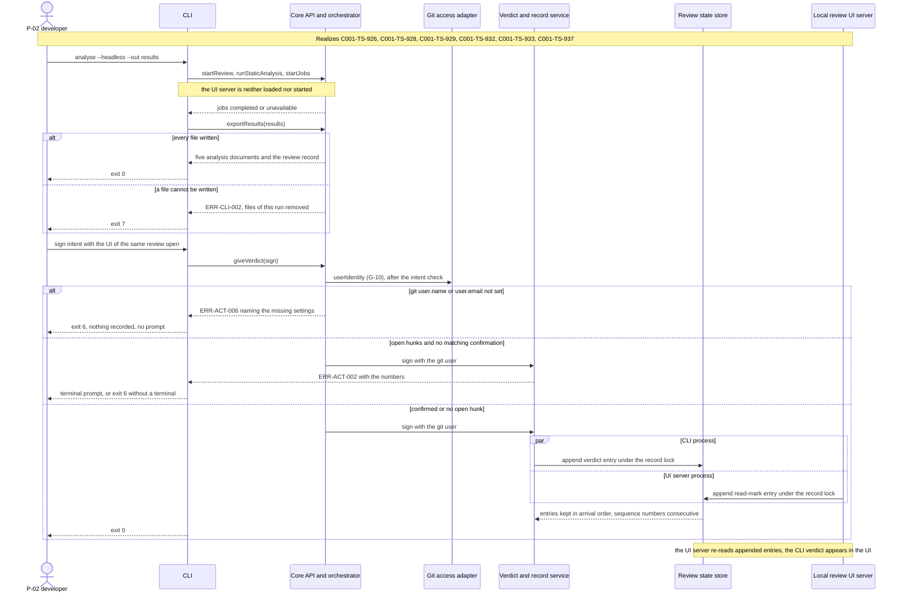

# Headless analysis and CLI verdict (realizes C001-TS-926, C001-TS-928, C001-TS-929, C001-TS-932, C001-TS-933, C001-TS-937)

Flow of `architecture.md` §3. Commands and exit codes: `50-interfaces/review-cli.md`. The headless
analysis writes no record entry and needs no git identity; the verdict does (C001-REQ-721).

