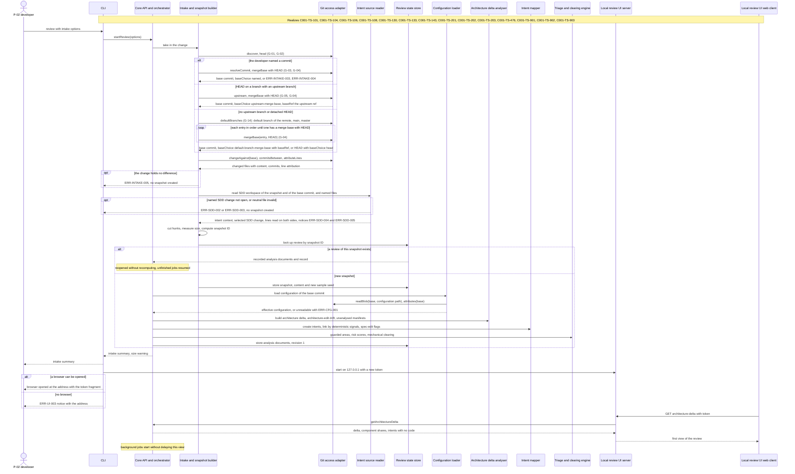

# Intake to architecture delta (realizes C001-TS-101, C001-TS-104, C001-TS-106, C001-TS-108, C001-TS-130, C001-TS-133, C001-TS-143, C001-TS-201, C001-TS-202, C001-TS-203, C001-TS-476, C001-TS-901, C001-TS-902, C001-TS-903)

Flow of `architecture.md` §3. Errors stop intake before any snapshot is stored
(`50-interfaces/errors.md`, ERR-INTAKE, ERR-CTX, ERR-SDD). The choice of the base commit follows
`50-interfaces/git-access.md` §4 (C001-REQ-102 to C001-REQ-104); the intake summary names the case
(`50-interfaces/review-cli.md` §Output).

