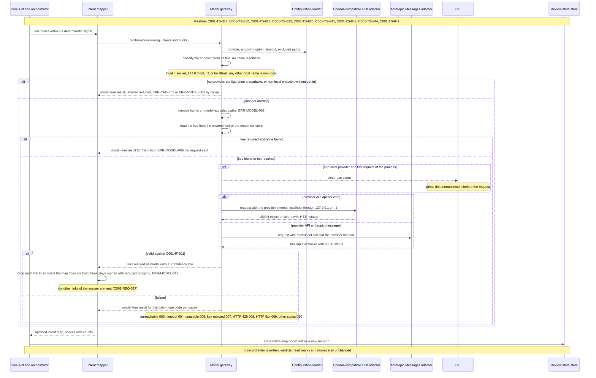

# Model-assisted analysis with fallback (realizes C001-TS-317, C001-TS-812, C001-TS-814, C001-TS-822, C001-TS-835, C001-TS-841, C001-TS-843, C001-TS-844, C001-TS-847)

Flow of `architecture.md` §3. Gateway checks and adapters: `50-interfaces/model-provider.md`;
endpoint classification §6, key lookup and failure codes (ERR-MODEL-nnn of
`50-interfaces/errors.md`) §7.
Shown for one hunk-linking batch; intent extraction, design critique and walkthrough accounts
follow the same path. C001-REQ-327 and C001-REQ-819 have no scenario IDs yet.

