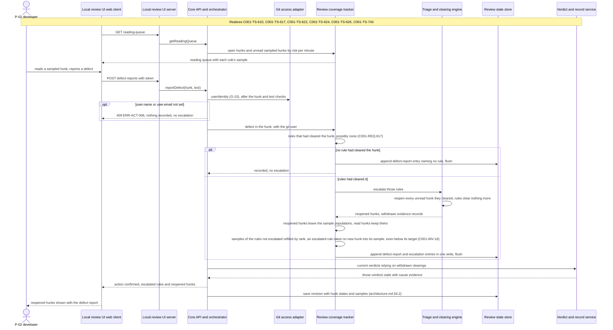

# Sampling, defect report and escalation (realizes C001-TS-610, C001-TS-617, C001-TS-622, C001-TS-624, C001-TS-626, C001-TS-743)

Flow of `architecture.md` §3. Sample rule: C001-INV-16; rule states: `40-domain/state-machines.md`
§6; sample membership: §8 of the same file; save and restore of the entries and the samples:
`architecture.md` §4.2. The `opt` block ends the flow when the git identity is not set
(C001-REQ-721).

