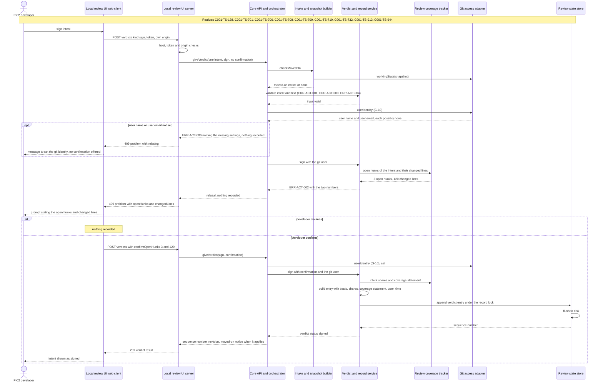

# Signing an intent with unread hunks (realizes C001-TS-138, C001-TS-701, C001-TS-706, C001-TS-708, C001-TS-709, C001-TS-710, C001-TS-732, C001-TS-913, C001-TS-944)

Flow of `architecture.md` §3. Verdict states: `40-domain/state-machines.md` §2; entry format:
`50-interfaces/review-record.schema.json` `VerdictEntry`; order of the verdict checks:
`50-interfaces/core-api.md` §4. The `opt` block ends the flow when the git identity is not set
(ERR-ACT-006, C001-REQ-721); the orchestrator applies the same identity check to every action that
writes a record entry.

