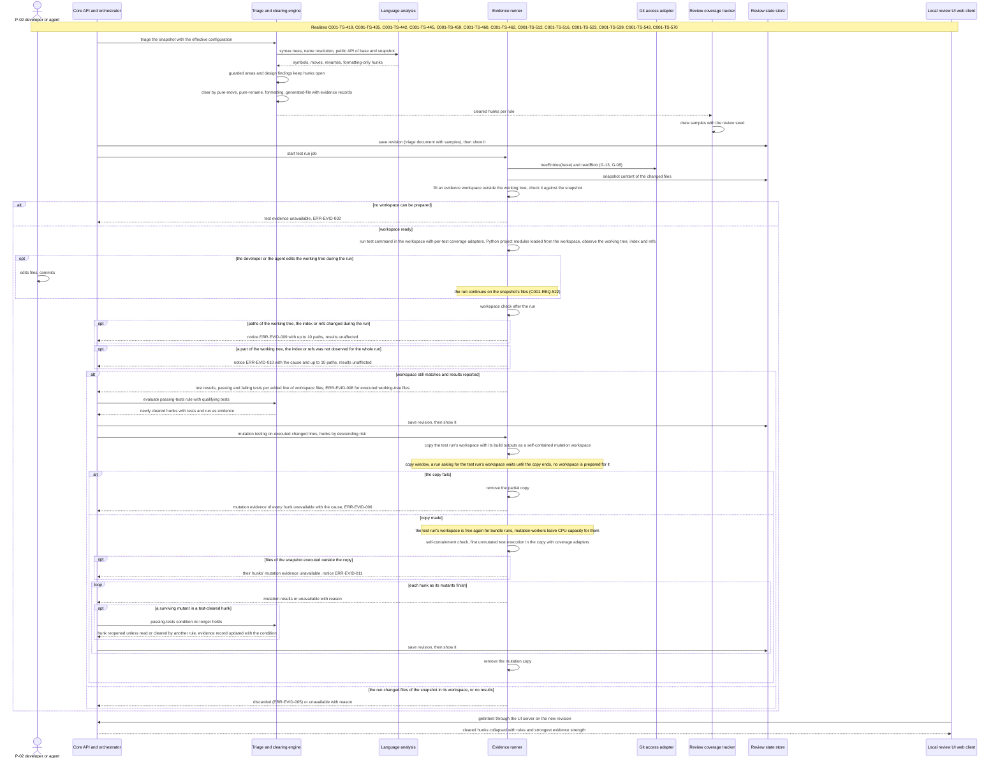

# Triage and clearing with evidence (realizes C001-TS-419, C001-TS-435, C001-TS-442, C001-TS-445, C001-TS-459, C001-TS-460, C001-TS-462, C001-TS-512, C001-TS-516, C001-TS-523, C001-TS-539, C001-TS-543, C001-TS-570)

Flow of `architecture.md` §3. Hunk states: `40-domain/state-machines.md` §1; test run and mutation
states: §4 and §5; run conventions and evidence workspaces: `50-interfaces/evidence-runs.md`;
revisions: `architecture.md` §4.2. No step of the analysis core writes to the developer's working
tree, and no run starts in it; the working tree is only observed during a run, for notice
ERR-EVID-009 and, for parts it could not observe, ERR-EVID-010 (C001-REQ-521, C001-REQ-522,
C001-REQ-523, C001-REQ-524, `50-interfaces/evidence-runs.md` §9). Mutation testing runs in a
self-contained copy of the test run's workspace and leaves CPU capacity for bundle runs
(`50-interfaces/evidence-runs.md` §1 item 4, §2 item 3, §5 item 4).

