# C001 — Work breakdown

Milestones and their goals: `10-strategy.md` §5. Tasks: `50-tasks/`. Estimates: S ≤ ½ day,
M ≤ 1 day, L ≤ 2 days of one person (implementer, moderator, seeder or rater). Total: 116 tasks
(2 S, 48 M, 66 L), about 181 person-days. Calendar time that is longer than the effort (study
recruitment and sessions) is set in `60-test-plan.md` §6 item 11 and applied in §2 below.

## 1. Dependency graph

```mermaid
flowchart LR
  subgraph C001_M_01["C001-M-01 Walking skeleton and measurements"]
    C001_T_001["T-001 Scaffold and CI"]
    C001_T_002["T-002 Licence and version check"]
    C001_T_003["T-003 Types, errors, log"]
    C001_T_004["T-004 Acceptance harness"]
    C001_T_005["T-005 Git process and safety"]
    C001_T_006["T-006 Git read operations"]
    C001_T_007["T-007 Store foundation"]
    C001_T_008["T-008 Intake diff and snapshot"]
    C001_T_009["T-009 Core API and orchestrator"]
    C001_T_010["T-010 CLI and headless output"]
    C001_T_011["T-011 UI server"]
    C001_T_012["T-012 Web client and review command"]
    C001_T_013["T-013 Benchmark set"]
    C001_T_014["T-014 Spike parse speed and memory"]
    C001_T_015["T-015 Workspace fill, reset, check"]
    C001_T_016["T-016 Copier and mutation copy"]
    C001_T_017["T-017 Observer Linux"]
    C001_T_018["T-018 Observer macOS and Windows"]
    C001_T_019["T-019 Command runner"]
    C001_T_020["T-020 Spike evidence harness"]
    C001_T_021["T-021 Measurements W1-W6"]
    C001_T_022["T-022 Kill tests K1-K6"]
    C001_T_023["T-023 Spike UI response"]
    C001_T_024["T-024 Decision point DP-1"]
    C001_T_104["T-104 Windows 11 runner"]
  end
  subgraph C001_M_02["C001-M-02 Intake, intent sources, configuration"]
    C001_T_025["T-025 Default base commit"]
    C001_T_026["T-026 Empty, binary, size"]
    C001_T_027["T-027 Commits and attribution"]
    C001_T_028["T-028 Clean-filter intake"]
    C001_T_029["T-029 SDD workspace reader"]
    C001_T_030["T-030 Neutral and named files"]
    C001_T_031["T-031 SDD change selection"]
    C001_T_032["T-032 Plans, transcripts, mentions"]
    C001_T_033["T-033 Intake summary, moved-on"]
    C001_T_034["T-034 Reopen and history"]
    C001_T_035["T-035 Configuration loader"]
  end
  subgraph C001_M_03["C001-M-03 Static analysis and triage"]
    C001_T_036["T-036 Parser port"]
    C001_T_037["T-037 Symbols and imports"]
    C001_T_038["T-038 Manifests, public API, trees"]
    C001_T_039["T-039 Component placement"]
    C001_T_040["T-040 Dependencies, packages, drift"]
    C001_T_041["T-041 Design-quality findings"]
    C001_T_042["T-042 Architecture-delta document"]
    C001_T_043["T-043 Architecture view"]
    C001_T_044["T-044 Intents from sources"]
    C001_T_045["T-045 Deterministic linking"]
    C001_T_046["T-046 Spec-edit flags, accounts"]
    C001_T_047["T-047 Hunk moves, named intents"]
    C001_T_048["T-048 Intent map view"]
    C001_T_049["T-049 Built-in guarded areas"]
    C001_T_050["T-050 Public API, configured areas"]
    C001_T_051["T-051 Risk scoring"]
    C001_T_052["T-052 Move and rename clearing"]
    C001_T_053["T-053 Mechanical clearing, guards"]
    C001_T_054["T-054 Test hunks, walkthrough order"]
    C001_T_055["T-055 Hunk states, triage document"]
    C001_T_056["T-056 Hunk view"]
  end
  subgraph C001_M_04["C001-M-04 Executable evidence"]
    C001_T_057["T-057 Node coverage adapter"]
    C001_T_058["T-058 Python hook and adapter"]
    C001_T_059["T-059 .NET coverage adapter"]
    C001_T_060["T-060 Test run on the snapshot"]
    C001_T_061["T-061 Judgements, passing-test clearing"]
    C001_T_062["T-062 Stryker tools"]
    C001_T_063["T-063 Python mutation engine"]
    C001_T_064["T-064 Mutation job and reopen"]
    C001_T_065["T-065 Evidence bundles"]
    C001_T_066["T-066 Counter-examples, strength"]
    C001_T_067["T-067 Workspace filters, submodules"]
    C001_T_068["T-068 Evidence views"]
    C001_T_069["T-069 Repository safety integration"]
  end
  subgraph C001_M_05["C001-M-05 Coverage, verdicts, record"]
    C001_T_070["T-070 Read marks, shares"]
    C001_T_071["T-071 Sampling"]
    C001_T_072["T-072 Defects, escalation"]
    C001_T_073["T-073 Attention budget"]
    C001_T_074["T-074 Coverage statement"]
    C001_T_075["T-075 Coverage views"]
    C001_T_076["T-076 Verdicts and identity"]
    C001_T_077["T-077 Orphan decisions"]
    C001_T_078["T-078 Verdict resolution, staleness"]
    C001_T_079["T-079 Record integrity, reader"]
    C001_T_080["T-080 Restore, crash safety"]
    C001_T_081["T-081 Concurrent surfaces"]
    C001_T_082["T-082 CLI verdicts, listing"]
    C001_T_083["T-083 Verdict views"]
    C001_T_084["T-084 Navigation, keyboard"]
  end
  subgraph C001_M_06["C001-M-06 Model provider"]
    C001_T_085["T-085 Gateway, model-free mode"]
    C001_T_086["T-086 Keys, credential readers"]
    C001_T_087["T-087 Provider adapters"]
    C001_T_088["T-088 Egress rules"]
    C001_T_089["T-089 Validation, failures"]
    C001_T_090["T-090 Model tasks"]
    C001_T_091["T-091 Model output in the UI"]
  end
  subgraph C001_M_07["C001-M-07 Release evidence"]
    C001_T_092["T-092 Security suite"]
    C001_T_093["T-093 Performance benchmarks"]
    C001_T_094["T-094 UI response benchmark"]
    C001_T_095["T-095 Network egress tests"]
    C001_T_096["T-096 Fault injection"]
    C001_T_097["T-097 Reproducibility, offline CI"]
    C001_T_098["T-098 Open-share measurement"]
    C001_T_099["T-099 Risk-weight calibration run"]
    C001_T_100["T-100 OS, browser, language matrix"]
    C001_T_101["T-101 User documentation"]
    C001_T_102["T-102 Study rating and analysis"]
    C001_T_103["T-103 Release compliance, 1.0.0"]
    C001_T_105["T-105 Publish release candidate"]
    C001_T_106["T-106 Calibration corpus changes"]
    C001_T_107["T-107 Calibration seeding 1-6"]
    C001_T_108["T-108 Calibration seeding 7-12"]
    C001_T_109["T-109 Study materials, analysis"]
    C001_T_110["T-110 Study change pool"]
    C001_T_111["T-111 Study seeding"]
    C001_T_112["T-112 Study recruitment"]
    C001_T_113["T-113 Study sessions rows 1-2"]
    C001_T_114["T-114 Study sessions rows 3-4"]
    C001_T_115["T-115 Study sessions rows 5-6"]
    C001_T_116["T-116 Study sessions rows 7-8"]
  end
  C001_T_001 --> C001_T_002
  C001_T_001 --> C001_T_003
  C001_T_002 --> C001_T_003
  C001_T_001 --> C001_T_104
  C001_T_002 --> C001_T_104
  C001_T_001 --> C001_T_004
  C001_T_003 --> C001_T_004
  C001_T_001 --> C001_T_005
  C001_T_002 --> C001_T_005
  C001_T_003 --> C001_T_005
  C001_T_005 --> C001_T_006
  C001_T_003 --> C001_T_007
  C001_T_006 --> C001_T_008
  C001_T_007 --> C001_T_008
  C001_T_007 --> C001_T_009
  C001_T_008 --> C001_T_009
  C001_T_009 --> C001_T_010
  C001_T_004 --> C001_T_010
  C001_T_009 --> C001_T_011
  C001_T_011 --> C001_T_012
  C001_T_010 --> C001_T_012
  C001_T_001 --> C001_T_013
  C001_T_002 --> C001_T_013
  C001_T_006 --> C001_T_014
  C001_T_013 --> C001_T_014
  C001_T_006 --> C001_T_015
  C001_T_007 --> C001_T_015
  C001_T_008 --> C001_T_015
  C001_T_015 --> C001_T_016
  C001_T_003 --> C001_T_017
  C001_T_017 --> C001_T_018
  C001_T_015 --> C001_T_019
  C001_T_016 --> C001_T_020
  C001_T_019 --> C001_T_020
  C001_T_017 --> C001_T_020
  C001_T_013 --> C001_T_020
  C001_T_020 --> C001_T_021
  C001_T_018 --> C001_T_021
  C001_T_020 --> C001_T_022
  C001_T_018 --> C001_T_022
  C001_T_012 --> C001_T_023
  C001_T_013 --> C001_T_023
  C001_T_014 --> C001_T_024
  C001_T_021 --> C001_T_024
  C001_T_022 --> C001_T_024
  C001_T_023 --> C001_T_024
  C001_T_008 --> C001_T_025
  C001_T_008 --> C001_T_026
  C001_T_012 --> C001_T_026
  C001_T_008 --> C001_T_027
  C001_T_006 --> C001_T_028
  C001_T_008 --> C001_T_028
  C001_T_008 --> C001_T_029
  C001_T_029 --> C001_T_030
  C001_T_029 --> C001_T_031
  C001_T_030 --> C001_T_032
  C001_T_012 --> C001_T_033
  C001_T_025 --> C001_T_033
  C001_T_009 --> C001_T_034
  C001_T_006 --> C001_T_035
  C001_T_003 --> C001_T_035
  C001_T_024 --> C001_T_036
  C001_T_014 --> C001_T_036
  C001_T_036 --> C001_T_037
  C001_T_036 --> C001_T_038
  C001_T_037 --> C001_T_039
  C001_T_029 --> C001_T_039
  C001_T_039 --> C001_T_040
  C001_T_038 --> C001_T_040
  C001_T_040 --> C001_T_041
  C001_T_041 --> C001_T_042
  C001_T_042 --> C001_T_043
  C001_T_048 --> C001_T_043
  C001_T_055 --> C001_T_043
  C001_T_031 --> C001_T_044
  C001_T_032 --> C001_T_044
  C001_T_027 --> C001_T_044
  C001_T_044 --> C001_T_045
  C001_T_037 --> C001_T_045
  C001_T_045 --> C001_T_046
  C001_T_029 --> C001_T_046
  C001_T_045 --> C001_T_047
  C001_T_007 --> C001_T_047
  C001_T_046 --> C001_T_048
  C001_T_047 --> C001_T_048
  C001_T_012 --> C001_T_048
  C001_T_035 --> C001_T_049
  C001_T_036 --> C001_T_049
  C001_T_049 --> C001_T_050
  C001_T_038 --> C001_T_050
  C001_T_049 --> C001_T_051
  C001_T_040 --> C001_T_051
  C001_T_038 --> C001_T_052
  C001_T_008 --> C001_T_052
  C001_T_049 --> C001_T_052
  C001_T_052 --> C001_T_053
  C001_T_049 --> C001_T_053
  C001_T_050 --> C001_T_053
  C001_T_041 --> C001_T_053
  C001_T_036 --> C001_T_054
  C001_T_045 --> C001_T_054
  C001_T_053 --> C001_T_055
  C001_T_051 --> C001_T_055
  C001_T_054 --> C001_T_055
  C001_T_055 --> C001_T_056
  C001_T_023 --> C001_T_056
  C001_T_048 --> C001_T_056
  C001_T_060 --> C001_T_057
  C001_T_060 --> C001_T_058
  C001_T_060 --> C001_T_059
  C001_T_024 --> C001_T_060
  C001_T_019 --> C001_T_060
  C001_T_009 --> C001_T_060
  C001_T_057 --> C001_T_061
  C001_T_058 --> C001_T_061
  C001_T_059 --> C001_T_061
  C001_T_055 --> C001_T_061
  C001_T_057 --> C001_T_062
  C001_T_059 --> C001_T_062
  C001_T_016 --> C001_T_062
  C001_T_058 --> C001_T_063
  C001_T_016 --> C001_T_063
  C001_T_062 --> C001_T_064
  C001_T_063 --> C001_T_064
  C001_T_061 --> C001_T_064
  C001_T_060 --> C001_T_065
  C001_T_032 --> C001_T_065
  C001_T_060 --> C001_T_066
  C001_T_015 --> C001_T_067
  C001_T_028 --> C001_T_067
  C001_T_060 --> C001_T_067
  C001_T_034 --> C001_T_067
  C001_T_065 --> C001_T_068
  C001_T_066 --> C001_T_068
  C001_T_056 --> C001_T_068
  C001_T_061 --> C001_T_068
  C001_T_060 --> C001_T_069
  C001_T_064 --> C001_T_069
  C001_T_065 --> C001_T_069
  C001_T_018 --> C001_T_069
  C001_T_055 --> C001_T_070
  C001_T_070 --> C001_T_071
  C001_T_071 --> C001_T_072
  C001_T_070 --> C001_T_073
  C001_T_051 --> C001_T_073
  C001_T_072 --> C001_T_074
  C001_T_073 --> C001_T_074
  C001_T_074 --> C001_T_075
  C001_T_056 --> C001_T_075
  C001_T_074 --> C001_T_076
  C001_T_076 --> C001_T_077
  C001_T_047 --> C001_T_077
  C001_T_076 --> C001_T_078
  C001_T_077 --> C001_T_078
  C001_T_061 --> C001_T_078
  C001_T_007 --> C001_T_079
  C001_T_076 --> C001_T_079
  C001_T_079 --> C001_T_080
  C001_T_072 --> C001_T_080
  C001_T_064 --> C001_T_080
  C001_T_080 --> C001_T_081
  C001_T_012 --> C001_T_081
  C001_T_078 --> C001_T_082
  C001_T_010 --> C001_T_082
  C001_T_078 --> C001_T_083
  C001_T_077 --> C001_T_083
  C001_T_075 --> C001_T_083
  C001_T_083 --> C001_T_084
  C001_T_068 --> C001_T_084
  C001_T_048 --> C001_T_084
  C001_T_035 --> C001_T_085
  C001_T_009 --> C001_T_085
  C001_T_085 --> C001_T_086
  C001_T_085 --> C001_T_087
  C001_T_086 --> C001_T_088
  C001_T_087 --> C001_T_088
  C001_T_088 --> C001_T_089
  C001_T_089 --> C001_T_090
  C001_T_045 --> C001_T_090
  C001_T_046 --> C001_T_090
  C001_T_041 --> C001_T_090
  C001_T_090 --> C001_T_091
  C001_T_043 --> C001_T_091
  C001_T_048 --> C001_T_091
  C001_T_084 --> C001_T_105
  C001_T_090 --> C001_T_105
  C001_T_091 --> C001_T_105
  C001_T_099 --> C001_T_105
  C001_T_104 --> C001_T_105
  C001_T_084 --> C001_T_092
  C001_T_011 --> C001_T_092
  C001_T_105 --> C001_T_092
  C001_T_069 --> C001_T_093
  C001_T_090 --> C001_T_093
  C001_T_055 --> C001_T_093
  C001_T_105 --> C001_T_093
  C001_T_084 --> C001_T_094
  C001_T_023 --> C001_T_094
  C001_T_105 --> C001_T_094
  C001_T_091 --> C001_T_095
  C001_T_084 --> C001_T_095
  C001_T_105 --> C001_T_095
  C001_T_080 --> C001_T_096
  C001_T_081 --> C001_T_096
  C001_T_105 --> C001_T_096
  C001_T_084 --> C001_T_097
  C001_T_055 --> C001_T_097
  C001_T_042 --> C001_T_097
  C001_T_105 --> C001_T_097
  C001_T_069 --> C001_T_098
  C001_T_061 --> C001_T_098
  C001_T_070 --> C001_T_098
  C001_T_105 --> C001_T_098
  C001_T_013 --> C001_T_106
  C001_T_106 --> C001_T_107
  C001_T_107 --> C001_T_108
  C001_T_064 --> C001_T_099
  C001_T_073 --> C001_T_099
  C001_T_108 --> C001_T_099
  C001_T_084 --> C001_T_100
  C001_T_091 --> C001_T_100
  C001_T_069 --> C001_T_100
  C001_T_104 --> C001_T_100
  C001_T_105 --> C001_T_100
  C001_T_002 --> C001_T_109
  C001_T_013 --> C001_T_110
  C001_T_106 --> C001_T_110
  C001_T_109 --> C001_T_110
  C001_T_110 --> C001_T_111
  C001_T_109 --> C001_T_112
  C001_T_084 --> C001_T_101
  C001_T_082 --> C001_T_101
  C001_T_086 --> C001_T_101
  C001_T_110 --> C001_T_101
  C001_T_093 --> C001_T_113
  C001_T_100 --> C001_T_113
  C001_T_101 --> C001_T_113
  C001_T_105 --> C001_T_113
  C001_T_111 --> C001_T_113
  C001_T_112 --> C001_T_113
  C001_T_113 --> C001_T_114
  C001_T_114 --> C001_T_115
  C001_T_115 --> C001_T_116
  C001_T_116 --> C001_T_102
  C001_T_092 --> C001_T_103
  C001_T_093 --> C001_T_103
  C001_T_094 --> C001_T_103
  C001_T_095 --> C001_T_103
  C001_T_096 --> C001_T_103
  C001_T_097 --> C001_T_103
  C001_T_098 --> C001_T_103
  C001_T_099 --> C001_T_103
  C001_T_100 --> C001_T_103
  C001_T_101 --> C001_T_103
  C001_T_102 --> C001_T_103
```

## 2. Critical path

Longest chain by estimate: 35 tasks, about 60 working days of effort along the chain (S = 0.5,
M = 1, L = 2). Calendar: the study part of the chain (C001-T-113 to C001-T-116 and C001-T-102,
10 days of effort) takes 4 weeks and 2 days, 22 working days, from S to the study result
(`60-test-plan.md` §6 item 11), so the chain takes about 72 working days from the start of
C001-T-001 to the publication of `1.0.0`. Recruitment (C001-T-112, 5 weeks) and the other steps
before S run in parallel and start at S − 6 weeks, 6 weeks before C001-T-113.

1. C001-T-001 (L) — Package scaffold, build, formatters and linters, and hosted CI matrix
2. C001-T-002 (M) — Confirm the licence and version facts of the ADRs (before every task that adds a dependency, `10-strategy.md` §2)
3. C001-T-003 (M) — Generated interface types, error catalogue and contextual log
4. C001-T-005 (L) — Git access adapter: program check and hardened read-only execution
5. C001-T-006 (L) — Git access adapter: read operations and working-tree comparison
6. C001-T-008 (L) — Intake: named base commit, histogram diff, hunks and snapshot
7. C001-T-015 (L) — Evidence workspace: location, fill, reset, check and lifetime
8. C001-T-016 (L) — Copier, ignored paths made available, link retargeting and mutation copy
9. C001-T-020 (L) — Spike: coverage and mutation harness for the workspace measurements
10. C001-T-021 (L) — Workspace measurements W1 to W6 (C001-T-022 runs in parallel with equal length)
11. C001-T-024 (S) — Decision point DP-1
12. C001-T-036 (L) — Parser port, tree-sitter grammars, ecosystem assignment and worker pool
13. C001-T-037 (L) — Language analysis: symbols, definitions, uses and import statements
14. C001-T-039 (L) — Architecture delta: components, placement and amount of change
15. C001-T-040 (L) — Architecture delta: dependencies, packages and drift
16. C001-T-041 (L) — Design-quality findings
17. C001-T-053 (L) — Formatting and generated-file clearing, evidence records and keep-open guards
18. C001-T-055 (S) — Hunk review states, developer reopen and the triage document
19. C001-T-070 (M) — Read marks and the read, cleared and open shares
20. C001-T-071 (L) — Random samples of each rule's cleared hunks
21. C001-T-072 (L) — Defect reports, rule escalation and reopening
22. C001-T-074 (M) — Coverage statement
23. C001-T-076 (L) — Sign, reject and defer verdicts with basis and git identity
24. C001-T-077 (M) — Orphan-hunk rejection and decisions through a later intent
25. C001-T-078 (L) — Current verdict per intent, staleness with causes, and decision status
26. C001-T-083 (L) — Verdicts, orphan decisions and staleness in the review UI
27. C001-T-084 (M) — Navigation and keyboard operation
28. C001-T-105 (M) — Publishing account and release-candidate publication
29. C001-T-093 (L) — Performance benchmarks on the release candidate (C001-T-100 and C001-T-101 end 1 day earlier)
30. C001-T-113 (L) — Study sessions, rows 1 and 2
31. C001-T-114 (L) — Study sessions, rows 3 and 4
32. C001-T-115 (L) — Study sessions, rows 5 and 6
33. C001-T-116 (L) — Study sessions, rows 7 and 8
34. C001-T-102 (L) — Study rating and analysis
35. C001-T-103 (L) — Release compliance and the `1.0.0` publication

Near-critical tasks: C001-T-100 and C001-T-101 (1 day of slack before C001-T-113); C001-T-082 and
C001-T-022. C001-T-092, C001-T-094 to C001-T-098 wait for C001-T-105 and have about 10 days of slack
before C001-T-103. The evidence chain C001-T-060 → C001-T-061 → C001-T-064 → C001-T-080 →
C001-T-081 → C001-T-096 feeds C001-T-078 and C001-T-105 with slack; a DP-1 outcome that blocks
C001-M-04 consumes it first and then delays C001-T-078 and the critical path. The calibration
chain C001-T-106 → C001-T-107 → C001-T-108 ends about 23 days of effort before C001-T-099 can start,
and C001-T-099 has about 9 days of slack before C001-T-105 (C001-RISK-021).

## 3. Tasks

| Milestone | Task | Title | Estimate | Depends on |
|---|---|---|---|---|
| C001-M-01 | C001-T-001 | Package scaffold, build, formatters and linters, and hosted CI matrix | L | — |
| C001-M-01 | C001-T-002 | Confirm the licence and version facts of the ADRs | M | C001-T-001 |
| C001-M-01 | C001-T-003 | Generated interface types, error catalogue and contextual log | M | C001-T-001, C001-T-002 |
| C001-M-01 | C001-T-004 | Acceptance harness, fixture repository builder and stub provider | L | C001-T-001, C001-T-003 |
| C001-M-01 | C001-T-005 | Git access adapter: program check and hardened read-only execution | L | C001-T-001, C001-T-002, C001-T-003 |
| C001-M-01 | C001-T-006 | Git access adapter: read operations and working-tree comparison | L | C001-T-005 |
| C001-M-01 | C001-T-007 | Review state store: layout, record append and revision switch | L | C001-T-003 |
| C001-M-01 | C001-T-008 | Intake: named base commit, histogram diff, hunks and snapshot | L | C001-T-006, C001-T-007 |
| C001-M-01 | C001-T-009 | Core API and orchestrator skeleton | M | C001-T-007, C001-T-008 |
| C001-M-01 | C001-T-010 | CLI skeleton, headless analysis output and exit codes | M | C001-T-009, C001-T-004 |
| C001-M-01 | C001-T-011 | Local review UI server with host, token, origin and CSP checks | L | C001-T-009 |
| C001-M-01 | C001-T-012 | Web client shell and the review command | M | C001-T-011, C001-T-010 |
| C001-M-01 | C001-T-013 | Benchmark set, reference environment and measurement harness | L | C001-T-001, C001-T-002 |
| C001-M-01 | C001-T-014 | Spike: parsing speed and memory at the supported size | M | C001-T-006, C001-T-013 |
| C001-M-01 | C001-T-015 | Evidence workspace: location, fill, reset, check and lifetime | L | C001-T-006, C001-T-007, C001-T-008 |
| C001-M-01 | C001-T-016 | Copier, ignored paths made available, link retargeting and mutation copy | L | C001-T-015 |
| C001-M-01 | C001-T-017 | Working-tree observer: common model and Linux implementation | L | C001-T-003 |
| C001-M-01 | C001-T-018 | Working-tree observer: macOS and Windows implementations | L | C001-T-017 |
| C001-M-01 | C001-T-019 | Command runner for evidence commands | M | C001-T-015 |
| C001-M-01 | C001-T-020 | Spike: coverage and mutation harness for the workspace measurements | L | C001-T-016, C001-T-019, C001-T-017, C001-T-013 |
| C001-M-01 | C001-T-021 | Workspace measurements W1 to W6 | L | C001-T-020, C001-T-018 |
| C001-M-01 | C001-T-022 | Workspace kill tests K1 to K6 | L | C001-T-020, C001-T-018 |
| C001-M-01 | C001-T-023 | Spike: hunk list and file context response time | M | C001-T-012, C001-T-013 |
| C001-M-01 | C001-T-024 | Decision point DP-1: evaluate the milestone 1 measurements | S | C001-T-014, C001-T-021, C001-T-022, C001-T-023 |
| C001-M-01 | C001-T-104 | Windows 11 self-hosted runner, nightly and closing-commit triggers | L | C001-T-001, C001-T-002 |
| C001-M-02 | C001-T-025 | Default base commit and refusals of unusable bases | M | C001-T-008 |
| C001-M-02 | C001-T-026 | Empty change, binary files and the supported-size warning | M | C001-T-008, C001-T-012 |
| C001-M-02 | C001-T-027 | Commits of the change and hunk attribution | M | C001-T-008 |
| C001-M-02 | C001-T-028 | Files under a clean filter at intake | L | C001-T-006, C001-T-008 |
| C001-M-02 | C001-T-029 | Intent source reader: `.sdd/` workspace, spec items and documented architecture | L | C001-T-008 |
| C001-M-02 | C001-T-030 | Neutral intent-and-architecture file and named files | M | C001-T-029 |
| C001-M-02 | C001-T-031 | Selecting the SDD change | M | C001-T-029 |
| C001-M-02 | C001-T-032 | Plan items, transcript passages, recorded runs and mentions | M | C001-T-030 |
| C001-M-02 | C001-T-033 | Intake summary, snapshot content and the moved-on notice | M | C001-T-012, C001-T-025 |
| C001-M-02 | C001-T-034 | Reopen an existing snapshot and keep earlier snapshots | M | C001-T-009 |
| C001-M-02 | C001-T-035 | Configuration loader: base-commit configuration, floor and effective policy | L | C001-T-006, C001-T-003 |
| C001-M-03 | C001-T-036 | Parser port, tree-sitter grammars, ecosystem assignment and worker pool | L | C001-T-024, C001-T-014 |
| C001-M-03 | C001-T-037 | Language analysis: symbols, definitions, uses and import statements | L | C001-T-036 |
| C001-M-03 | C001-T-038 | Language analysis: manifests, public API, tree equality and executable lines | L | C001-T-036 |
| C001-M-03 | C001-T-039 | Architecture delta: components, placement and amount of change | L | C001-T-037, C001-T-029 |
| C001-M-03 | C001-T-040 | Architecture delta: dependencies, packages and drift | L | C001-T-039, C001-T-038 |
| C001-M-03 | C001-T-041 | Design-quality findings: cycles, layer bypasses, duplicated logic | L | C001-T-040 |
| C001-M-03 | C001-T-042 | Publish the architecture-delta document first | M | C001-T-041 |
| C001-M-03 | C001-T-043 | Architecture view in the review UI | L | C001-T-042, C001-T-048, C001-T-055 |
| C001-M-03 | C001-T-044 | Intent mapper: intents from requirements, commits and plan items | M | C001-T-031, C001-T-032, C001-T-027 |
| C001-M-03 | C001-T-045 | Intent mapper: deterministic links, orphan code and unmet intents | L | C001-T-044, C001-T-037 |
| C001-M-03 | C001-T-046 | Spec-edit flags and the deterministic account of each intent | M | C001-T-045, C001-T-029 |
| C001-M-03 | C001-T-047 | Hunk moves and developer-named intents as recorded actions | M | C001-T-045, C001-T-007 |
| C001-M-03 | C001-T-048 | Intent map view in the review UI | L | C001-T-046, C001-T-047, C001-T-012 |
| C001-M-03 | C001-T-049 | Built-in guarded areas: security, data migration, dependency and build | L | C001-T-035, C001-T-036 |
| C001-M-03 | C001-T-050 | Public API area, configured guarded areas and disabled rules | M | C001-T-049, C001-T-038 |
| C001-M-03 | C001-T-051 | Risk score, signal values and intent order | M | C001-T-049, C001-T-040 |
| C001-M-03 | C001-T-052 | Clearing rules: pure moves and pure renames | L | C001-T-038, C001-T-008, C001-T-049 |
| C001-M-03 | C001-T-053 | Formatting and generated-file clearing, evidence records and the keep-open guards | L | C001-T-052, C001-T-049, C001-T-050, C001-T-041 |
| C001-M-03 | C001-T-054 | Test hunks and the walkthrough order of an intent | M | C001-T-036, C001-T-045 |
| C001-M-03 | C001-T-055 | Hunk review states, developer reopen and the triage document | S | C001-T-053, C001-T-051, C001-T-054 |
| C001-M-03 | C001-T-056 | Hunk view: file context, risk signals, cleared hunks collapsed, moves and labels | L | C001-T-055, C001-T-023, C001-T-048 |
| C001-M-04 | C001-T-057 | Per-test coverage adapter and load monitor for TypeScript/JavaScript | L | C001-T-060 |
| C001-M-04 | C001-T-058 | Python import hook, per-test coverage adapter and load monitor | L | C001-T-060 |
| C001-M-04 | C001-T-059 | Per-test coverage adapter and load monitor for C#/.NET | L | C001-T-060 |
| C001-M-04 | C001-T-060 | Test run on the snapshot: job, workspace checks, coverage reports and failures | L | C001-T-024, C001-T-019, C001-T-009 |
| C001-M-04 | C001-T-061 | Test judgements and clearing by passing tests | L | C001-T-057, C001-T-058, C001-T-059, C001-T-055 |
| C001-M-04 | C001-T-062 | Mutation testing with StrykerJS and Stryker.NET in the mutation copy | L | C001-T-057, C001-T-059, C001-T-016 |
| C001-M-04 | C001-T-063 | Python mutation engine | L | C001-T-058, C001-T-016 |
| C001-M-04 | C001-T-064 | Mutation job scheduling, copy window and reopen on surviving mutants | M | C001-T-062, C001-T-063, C001-T-061 |
| C001-M-04 | C001-T-065 | Evidence bundles: keep, confirm, run and compare | L | C001-T-060, C001-T-032 |
| C001-M-04 | C001-T-066 | Property-test counter-examples and evidence strength | M | C001-T-060 |
| C001-M-04 | C001-T-067 | Evidence workspaces: clean-filter files, Git LFS files and submodules | L | C001-T-015, C001-T-028, C001-T-060, C001-T-034 |
| C001-M-04 | C001-T-068 | Evidence in the review UI: strength, bundles, judgements and comparisons | M | C001-T-065, C001-T-066, C001-T-056, C001-T-061 |
| C001-M-04 | C001-T-069 | Repository safety across all evidence runs | M | C001-T-060, C001-T-064, C001-T-065, C001-T-018 |
| C001-M-05 | C001-T-070 | Read marks and the read, cleared and open shares | M | C001-T-055 |
| C001-M-05 | C001-T-071 | Random samples of each rule's cleared hunks, stable under population change | L | C001-T-070 |
| C001-M-05 | C001-T-072 | Defect reports, rule escalation and reopening | L | C001-T-071 |
| C001-M-05 | C001-T-073 | Attention budget and the reading queue | M | C001-T-070, C001-T-051 |
| C001-M-05 | C001-T-074 | Coverage statement with covered and uncovered risk and sample results | M | C001-T-072, C001-T-073 |
| C001-M-05 | C001-T-075 | Shares, samples, defect reports and reading queue in the review UI | M | C001-T-074, C001-T-056 |
| C001-M-05 | C001-T-076 | Sign, reject and defer verdicts with basis and git identity | L | C001-T-074 |
| C001-M-05 | C001-T-077 | Orphan-hunk rejection and decisions through a later intent | M | C001-T-076, C001-T-047 |
| C001-M-05 | C001-T-078 | Current verdict per intent, staleness with causes, and decision status | L | C001-T-076, C001-T-077, C001-T-061 |
| C001-M-05 | C001-T-079 | Record integrity, reading the record without the UI, repository unchanged on decisions | M | C001-T-007, C001-T-076 |
| C001-M-05 | C001-T-080 | Restore of the review state and crash safety | L | C001-T-079, C001-T-072, C001-T-064 |
| C001-M-05 | C001-T-081 | Concurrent entries from the CLI and the UI, one server per snapshot | M | C001-T-080, C001-T-012 |
| C001-M-05 | C001-T-082 | CLI verdict commands, intent listing and status | M | C001-T-078, C001-T-010 |
| C001-M-05 | C001-T-083 | Verdicts, orphan decisions and staleness in the review UI | L | C001-T-078, C001-T-077, C001-T-075 |
| C001-M-05 | C001-T-084 | Navigation between components, intents and hunks, and keyboard operation | M | C001-T-083, C001-T-068, C001-T-048 |
| C001-M-06 | C001-T-085 | Model gateway: model use decision, model-free mode and reduced labels | M | C001-T-035, C001-T-009 |
| C001-M-06 | C001-T-086 | Provider keys: environment variables and per-OS credential-store readers | L | C001-T-085 |
| C001-M-06 | C001-T-087 | OpenAI-compatible chat and Anthropic Messages adapters | M | C001-T-085 |
| C001-M-06 | C001-T-088 | Gateway egress rules: locality, cloud opt-in, excluded paths and announcement | L | C001-T-086, C001-T-087 |
| C001-M-06 | C001-T-089 | Gateway output validation, model-output marking and failure fallback | L | C001-T-088 |
| C001-M-06 | C001-T-090 | Model tasks: extracted intents, model links, design critique and accounts | L | C001-T-089, C001-T-045, C001-T-046, C001-T-041 |
| C001-M-06 | C001-T-091 | Cloud banner and model output in the review UI | M | C001-T-090, C001-T-043, C001-T-048 |
| C001-M-07 | C001-T-106 | Calibration corpus: twelve agent changes with test command and environment | L | C001-T-013 |
| C001-M-07 | C001-T-107 | Calibration corpus: seed and label defects in changes 1 to 6 | L | C001-T-106 |
| C001-M-07 | C001-T-108 | Calibration corpus: seed and label defects in changes 7 to 12 | L | C001-T-107 |
| C001-M-07 | C001-T-109 | Comparison study: materials, record layout, assignment and analysis commands | M | C001-T-002 |
| C001-M-07 | C001-T-110 | Comparison study: change pool A to D and the practice change | L | C001-T-013, C001-T-106, C001-T-109 |
| C001-M-07 | C001-T-111 | Comparison study: defect seeding and sealed lists | L | C001-T-110 |
| C001-M-07 | C001-T-112 | Comparison study: recruitment, consent and assignment draw | M | C001-T-109 |
| C001-M-07 | C001-T-099 | Risk-weight calibration run | L | C001-T-064, C001-T-073, C001-T-108 |
| C001-M-07 | C001-T-105 | Publishing account and release-candidate publication on the public npm registry | M | C001-T-084, C001-T-090, C001-T-091, C001-T-099, C001-T-104 |
| C001-M-07 | C001-T-092 | Security suite: loopback only, cross-origin, DNS rebinding and CSP | L | C001-T-084, C001-T-011, C001-T-105 |
| C001-M-07 | C001-T-093 | Performance benchmarks: static analysis, model analysis, memory and evidence runs | L | C001-T-069, C001-T-090, C001-T-055, C001-T-105 |
| C001-M-07 | C001-T-094 | Review UI response benchmark over a 500-action session | M | C001-T-084, C001-T-023, C001-T-105 |
| C001-M-07 | C001-T-095 | Network egress tests: model-free, local provider and cloud provider | M | C001-T-091, C001-T-084, C001-T-105 |
| C001-M-07 | C001-T-096 | Fault-injection test of review-state durability | M | C001-T-080, C001-T-081, C001-T-105 |
| C001-M-07 | C001-T-097 | Reproducibility comparison and the offline model-free CI run | M | C001-T-084, C001-T-055, C001-T-042, C001-T-105 |
| C001-M-07 | C001-T-098 | Open-share measurement on the benchmark changes | M | C001-T-069, C001-T-061, C001-T-070, C001-T-105 |
| C001-M-07 | C001-T-100 | Operating-system, browser and language coverage runs | M | C001-T-084, C001-T-091, C001-T-069, C001-T-104, C001-T-105 |
| C001-M-07 | C001-T-101 | User documentation | L | C001-T-084, C001-T-082, C001-T-086, C001-T-110 |
| C001-M-07 | C001-T-113 | Comparison study: sessions of participant rows 1 and 2 | L | C001-T-093, C001-T-100, C001-T-101, C001-T-105, C001-T-111, C001-T-112 |
| C001-M-07 | C001-T-114 | Comparison study: sessions of participant rows 3 and 4 | L | C001-T-113 |
| C001-M-07 | C001-T-115 | Comparison study: sessions of participant rows 5 and 6 | L | C001-T-114 |
| C001-M-07 | C001-T-116 | Comparison study: sessions of participant rows 7 and 8 | L | C001-T-115 |
| C001-M-07 | C001-T-102 | Comparison study: rating and analysis against a standard diff review | L | C001-T-116 |
| C001-M-07 | C001-T-103 | Release compliance: secrets, vulnerabilities, licences, error logging and the 1.0.0 publication | L | C001-T-092, C001-T-093, C001-T-094, C001-T-095, C001-T-096, C001-T-097, C001-T-098, C001-T-099, C001-T-100, C001-T-101, C001-T-102 |
